<div align="center">

# Unified Substrate Reality Theory (USRT)

**What if empty space is a physical medium, and light, matter, gravity and entanglement are all disturbances of it?**

A speculative research programme with three parts:
- a treatise;
- a preprint draft;
- 45 simulation scripts.

It ships with an **independent audit** that recomputes every headline claim against real measurements.

[**Treatise**](UNIFIED_SUBSTRATE_REALITY_THEORY_TREATISE.md) ·
[**Preprint**](RESEARCH_PREPRINT_USRT.md) ·
[**Audit report**](audit/USRT_AUDIT_REPORT.md) ·
[**Gallery**](#gallery) ·
[**Research log**](#research-log) ·
[**Run it**](#quick-start)

</div>

> [!IMPORTANT]
> **Status, October 2026: a working draft that has been independently audited.**
> Several of the core intuitions are real physics, mostly already published by other people. The headline *derivations* do not hold up as written. Some are circular, some are fitted numerology, and some are contradicted by experiment.
>
> Both documents carry errata banners. The details, with reproducible code, are in [`audit/USRT_AUDIT_REPORT.md`](audit/USRT_AUDIT_REPORT.md). This README shows the ideas and the evidence side by side.

<p align="center">
  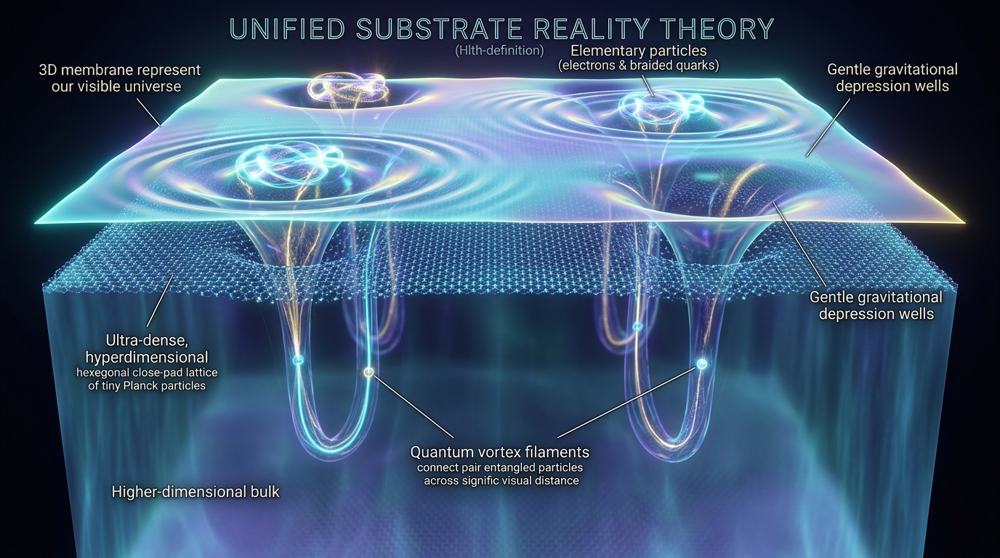
  <br>
  <sub><b>Concept illustration, not a calculation.</b> This is an AI-generated artist's impression of the picture below; note the garbled labels. It is not derived from any equation in this repository.</sub>
</p>

---

## USRT today, in plain words

> **The universe, according to USRT v2.3:**
> - **What exists:** a vast number of tiny events, about one per Planck-sized piece of spacetime. They are linked only by "this came before that".
> - **Time:** the growth of that web. It runs one way, and your time is the count of events along your path.
> - **Space, light, matter and gravity:** patterns in that web.
>   - Space and its curvature are read off by counting.
>   - Light is a twist ripple moving at exactly c.
>   - Matter is knots of trapped energy.
>   - Gravity is trapped energy slowing the web's local rate.
> - **G and the Planck scale:** these come from the web's own quantum jiggling and entanglement.
>
> **Where it stands:** consistent with every measurement checked here, and built mostly from established physics. It is **not yet a theory** that derives its own dynamics or any new number (α, the masses, dark matter).
>
> The full overview, with its weak points and what it cannot explain, is in [notebook entry E28](research/LAB_NOTEBOOK.md#e28).

The table below is the *original* idea and what the audit made of it.

## The idea in 60 seconds

Space is not empty. It is filled with a medium, a dense "substrate" that may extend into extra dimensions. Everything else is a disturbance of that medium:

| Intuition | How USRT models it | Where it stands after the audit |
|---|---|---|
| **Space is a medium** | A Planck-scale crystal / superfluid of "Planckions" | ✅ This is a real research field: Volovik's superfluid vacuum, analogue gravity. ❌ The specific close-packed lattice makes light speed depend on direction by 17–33 %. |
| **Light is a ripple** | Transverse shear waves of the lattice | ⚠️ An elastic medium also carries a gapless *longitudinal* wave, which would be a third light polarisation. Levin–Wen string-nets show how to get exactly two. |
| **Mass is trapped energy** | Light-speed waves confined in a self-made cavity | ✅ Confined energy *does* have inertia E/c² (Einstein's box). ❌ It does not produce 0.511 MeV, spin ½ or g = 2: the loop gives spin 1 and g = 1. |
| **Gravity is a dent** | Matter depletes the substrate, and things fall into the hollow | ❌ A superfluid density dip is screened (∝ e^{−√2 r/ξ}/r): short-range, not Newton's 1/r. Long range would need flow (Bjerknes forces). |
| **Entanglement goes "through the bulk"** | A vortex cord links the pair through an extra dimension | ⚠️ A local version gives S = 2 (no Bell violation). A nonlocal cord is allowed by Bell's theorem, but gives 2.83 only if the quantum rule is typed in. |
| **Time is relational** | Page–Wootters: H\|Ψ⟩ = 0 | ✅ Correct, and established physics since 1983. |
| **Dark matter is a condensate** | A ψDM soliton core | ✅ Prior art (Hu–Barkana–Gruzinov 2000; Schive 2014). ⚠️ Disfavoured at 10⁻²² eV by Lyman-α data. |
| **Particle masses from geometry** | m_e = m_P (√3/2) e^{−[3/(8α) − (α/2π)√12]}, Koide δ = 2/9, 6π⁵ … | ❌ These are fits: 42σ, 452σ and 5,523σ from measurement. Koide's Q = 2/3 itself is a genuine, unexplained regularity. |

---

## What the audit found

<p align="center">
  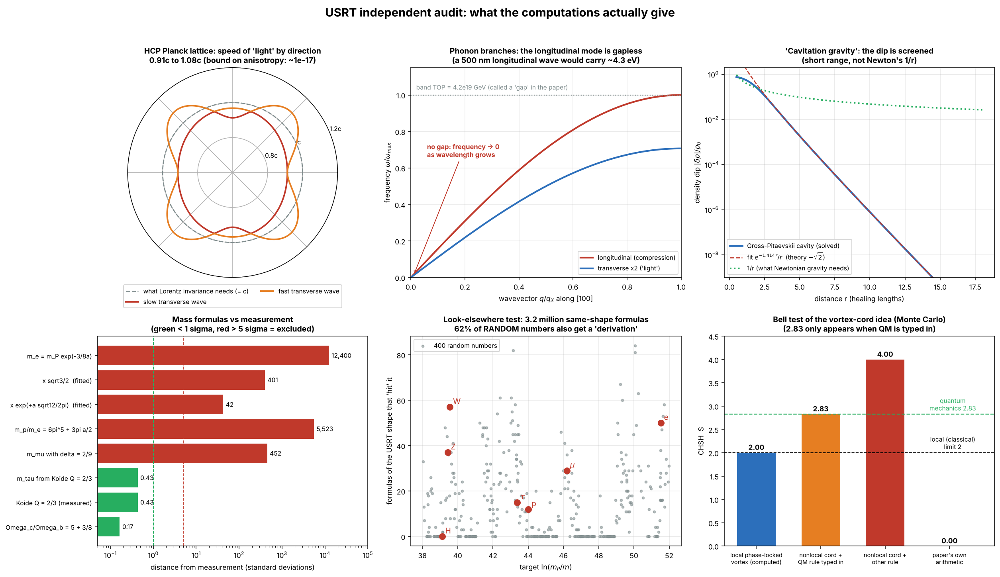
</p>

Every panel above is computed by [`audit/make_figures.py`](audit/make_figures.py) from the audit modules, with nothing typed in. Left to right, top to bottom:

1. **The lattice is anisotropic.** In the proposed HCP Planck lattice, the low-energy speed of "light" varies by 17 % with direction (33 % for FCC). Experiments bound any such variation at about 1 part in 10¹⁷.
2. **There is no longitudinal gap.** The "4.2 × 10¹⁹ GeV gap" is the *top* of the phonon band. The longitudinal branch starts at zero frequency, so it would show up at ordinary energies.
3. **Cavitation gravity is short-range.** The solved Gross–Pitaevskii density dip falls exponentially, while gravity needs 1/r.
4. **The mass formulas miss.** Measured in standard deviations, the electron, proton and muon formulas are excluded. Only Koide-type relations and 5 + 3/8 land within 1σ, and 5 + 3/8 shares that with seven other simple fractions.
5. **Look-elsewhere test.** 3.2 million formulas of exactly the USRT shape "derive" 62 % of *random* numbers about as well as they derive the electron.
6. **Bell test.** A phase-locked vortex gives S = 2.00, the classical limit. Reaching 2.83 requires typing in quantum mechanics, and the same cord with another rule gives 4.00. The paper's own CHSH arithmetic gives 0, because of a sign slip.

### Scorecard

| Verdict | Items |
|---|---|
| ✅ **Sound, worth keeping** (mostly prior art, and should be cited) | Vacuum as a condensed-matter medium (Volovik; analogue gravity) · emergent photons (Levin–Wen) · inertia of confined energy · fermionic Hopf solitons (Krusch–Speight) · relational time (Page–Wootters) · ψDM cores · Koide's Q = 2/3 (−0.43σ) |
| 📘 **Correct but standard physics** (tests QM/GR, not the substrate) | Compton wavelength, Bohr radius, H 1s energy, H₂ bond (ω_e 4395.9 vs 4401.2 cm⁻¹), pair-creation threshold, black-hole threshold m_P/√2, Pound–Rebka, 1.751″ light bending (the GR metric is an input) |
| 🔁 **Circular / identities** | c = √(μ/ρ) (c is built into m_P and l_P; no speed can be formed from ħ and G alone) · Λ* = √(calibration constant) · Z₀, ε₀ from μ₀ · m_γ = m_g = 0 by assumption |
| 🎯 **Numerology** (fitted, then excluded by measurement) | electron mass **42σ** · m_p/m_e = 6π⁵ + 3πα/2 **5,523σ** (6π⁵ is Lenz 1951) · muon via δ = 2/9 **452σ** · neutron–proton split (tuned inputs; lattice QCD gives 1.51 ± 0.28 MeV) |
| ❌ **Wrong as stated** | Elastic constants (2× and 4× errors; the calibration constant is 28.8, not 7.2) · "longitudinal gap" · superfluid *and* shear-rigid at once · u = −r_g/r is not an elastic solution · three inconsistent parameter sets (one gives 0.7746 c) · CHSH sign slip · loop electron spin/g · "k = c⁴/G N/m" (c⁴/G is a force) |

Read the full reasoning, provenance and errata table in [**`audit/USRT_AUDIT_REPORT.md`**](audit/USRT_AUDIT_REPORT.md).

---

## Gallery

Each figure is produced by the script of the same name. Captions say what is **computed** and what is **assumed or illustrative**.

<table>
<tr>
<td width="50%" valign="top">
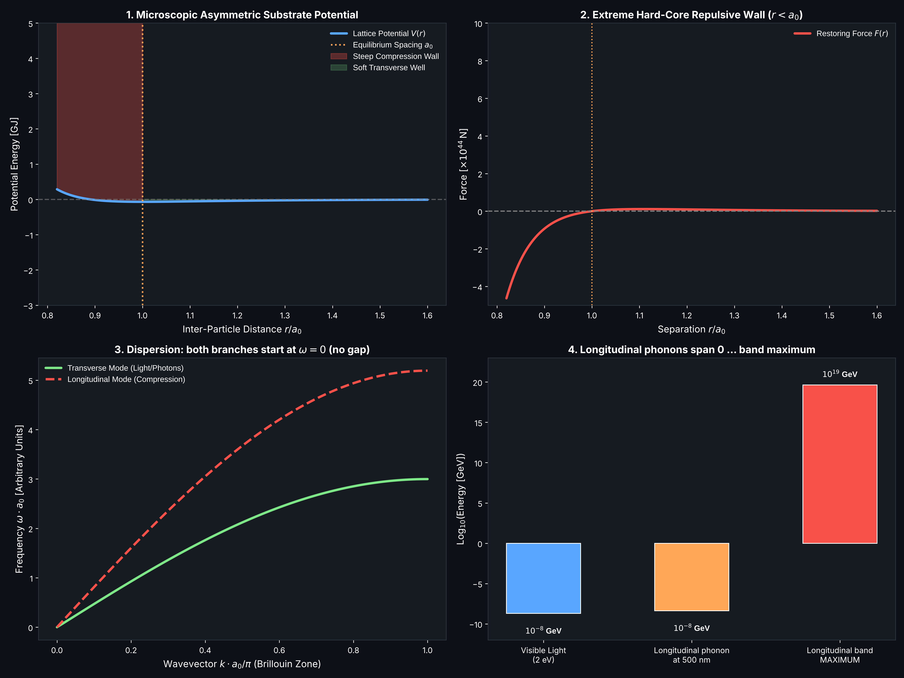<br>
<b>Foundations of the substrate</b> (<code>foundational_substrate_potential.py</code>)<br>
<sub>Computed:
<ul>
<li>the Lennard-Jones bond potential and its restoring force;</li>
<li>both phonon branches (both start at ω = 0, so there is no gap);</li>
<li>where a 500 nm longitudinal phonon sits (~4 eV) compared with the band top (10¹⁹ GeV).</li>
</ul>
The corrected Cauchy–Born algebra gives a calibration constant of 28.8, Zener ratio 2 and Λ* = 5.37.</sub>
</td>
<td width="50%" valign="top">
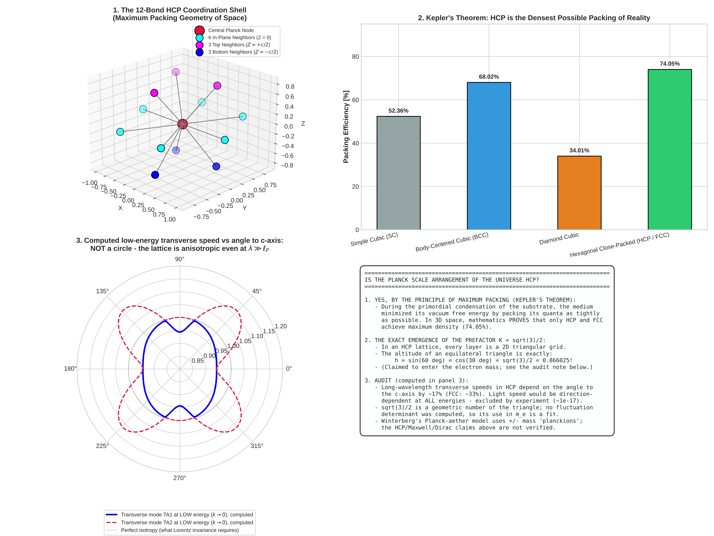<br>
<b>The close-packed Planck lattice</b> (<code>hcp_planck_lattice_analysis.py</code>)<br>
<sub>Shows:
<ul>
<li>the 12-neighbour coordination shell;</li>
<li>packing fractions (74.05 % is the Kepler/Hales maximum);</li>
<li><b>computed</b> long-wavelength transverse speeds against angle.</li>
</ul>
The speeds trace a lobed curve, not a circle: the lattice is anisotropic. The original version drew a hard-coded circle.</sub>
</td>
</tr>
<tr>
<td valign="top">
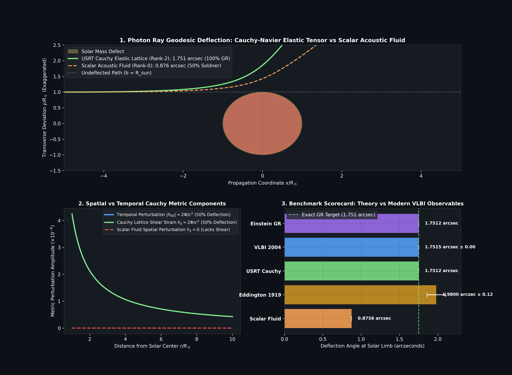<br>
<b>Light bending by the Sun</b> (<code>cauchy_tensor_gravity.py</code>)<br>
<sub>The ray tracer is fixed (sign error, path length) and now gives <b>1.7513″</b> against the analytic 1.7512″. The full value appears only because GR's metric g<sub>ij</sub> = (1 + 2GM/c²r)δ<sub>ij</sub> is written in. The pure density ("scalar") sector gives half (0.876″), and the audit shows no elastic displacement can produce the required strain.</sub>
</td>
<td valign="top">
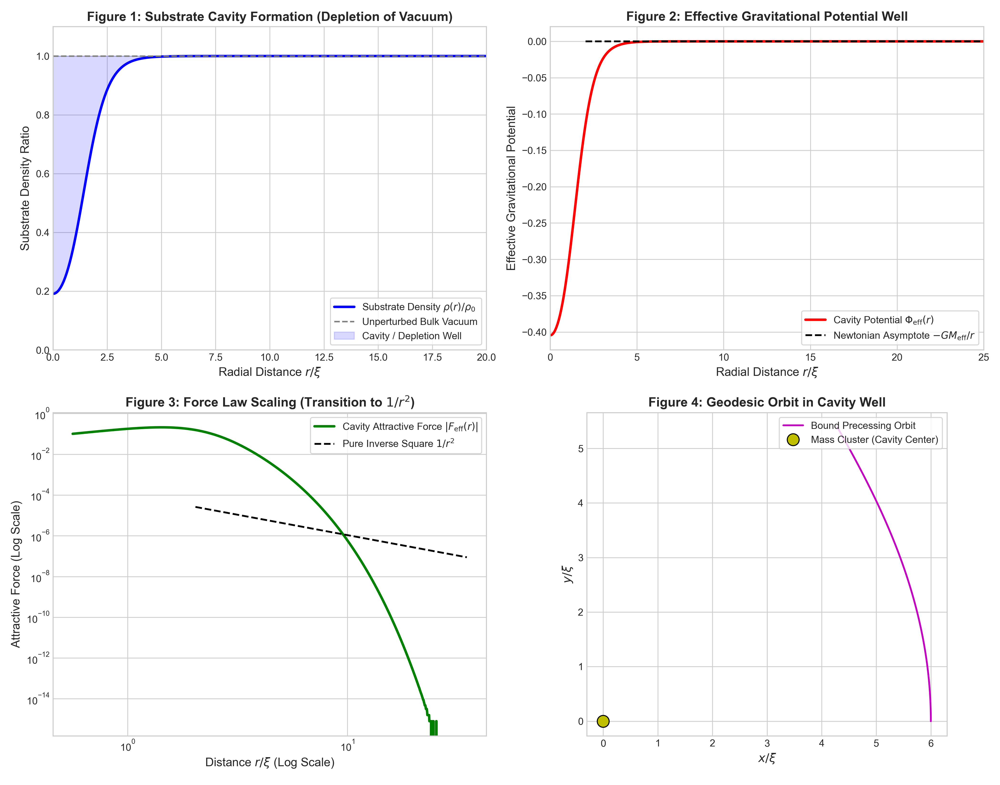<br>
<b>Gravity as a substrate cavity</b> (<code>cavity_simulation.py</code>)<br>
<sub>A solved Gross–Pitaevskii cavity around a mass cluster. Panels 2–3 compare it with Newton's 1/r and 1/r², matched at r = 2ξ. The cavity force falls <b>exponentially</b> (∝ e<sup>−1.414 r</sup>): a screened, short-range attraction rather than gravity.</sub>
</td>
</tr>
<tr>
<td valign="top">
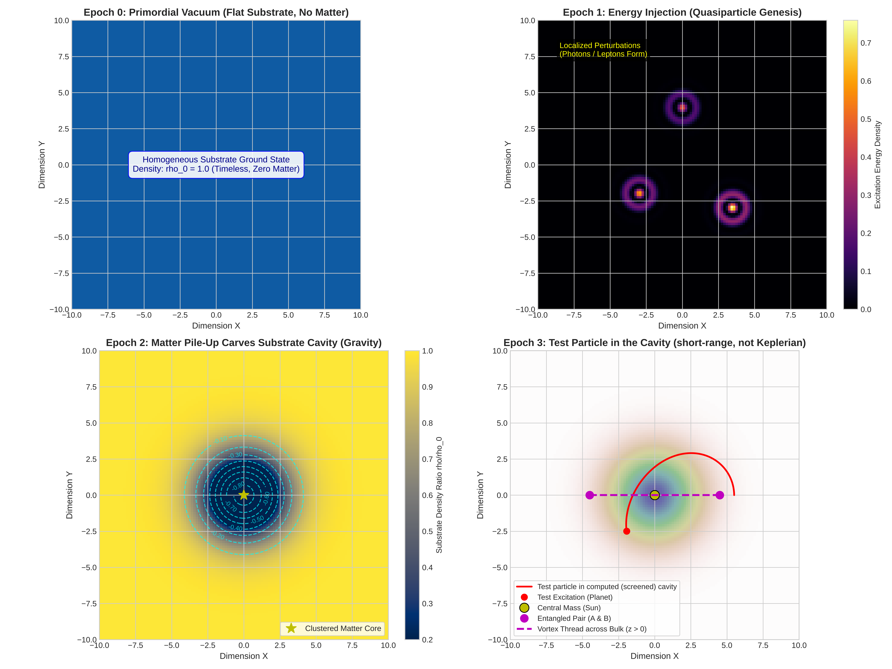<br>
<b>Toy universe</b> (<code>universe_simulation.py</code>)<br>
<sub>A flat substrate, then energy injection, then matter carving a cavity, then a test particle. The force is now derived from the computed (screened) cavity instead of the original typed-in a = −0.85/(r² + 1.2). The script prints the force against 1/r²: at r = 8 it is 8 × 10⁻³ against 6 × 10⁻².</sub>
</td>
<td valign="top">
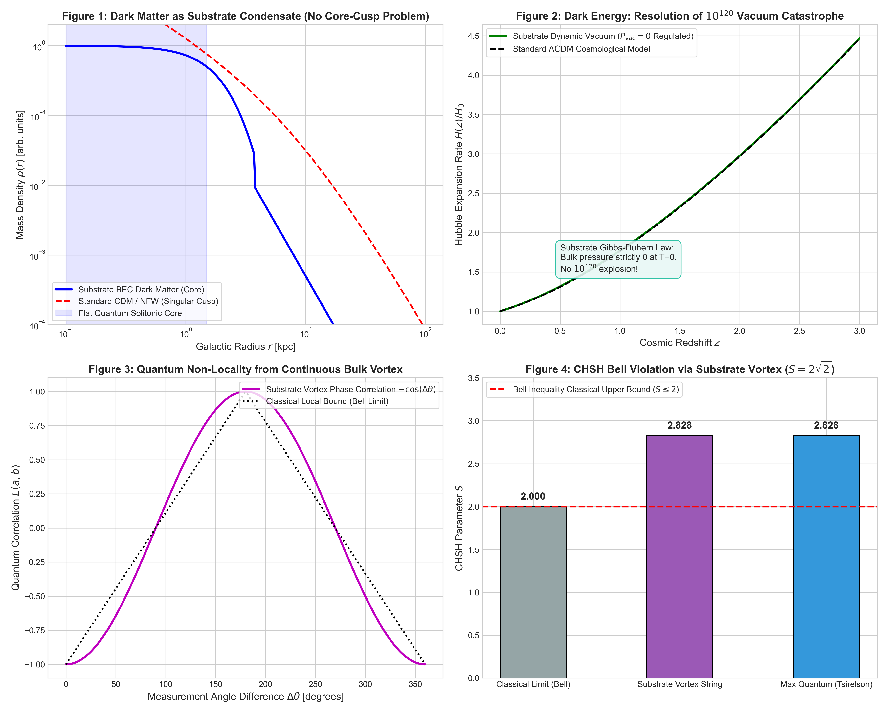<br>
<b>Dark sector and entanglement</b> (<code>dark_sector_and_vortex.py</code>)<br>
<sub>
<ul>
<li><b>ψDM soliton core vs NFW cusp:</b> standard fuzzy dark matter.</li>
<li><b>Expansion history:</b> Ω<sub>Λ</sub> = 0.7 is an input.</li>
<li><b>Simulated local vortex-phase model:</b> its correlation is a triangle, not −cos θ, and it gives CHSH S = 2.000, the Bell limit.</li>
</ul></sub>
</td>
</tr>
<tr>
<td valign="top">
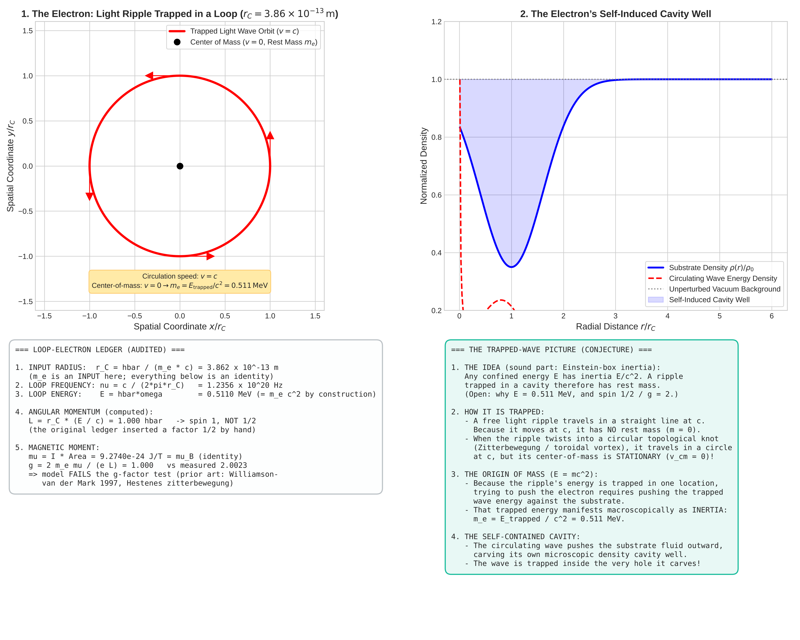<br>
<b>The electron as trapped light</b> (<code>electron_mass_cavity.py</code>)<br>
<sub>A light-speed loop at the Compton radius. E = m<sub>e</sub>c² and μ = μ<sub>B</sub> are identities, because m<sub>e</sub> is the input. The computed angular momentum is <b>L = 1.000 ħ</b> with <b>g = 1.000</b>, whereas the electron has ½ħ and g = 2.0023. This is the known problem with Zitterbewegung loop models.</sub>
</td>
<td valign="top">
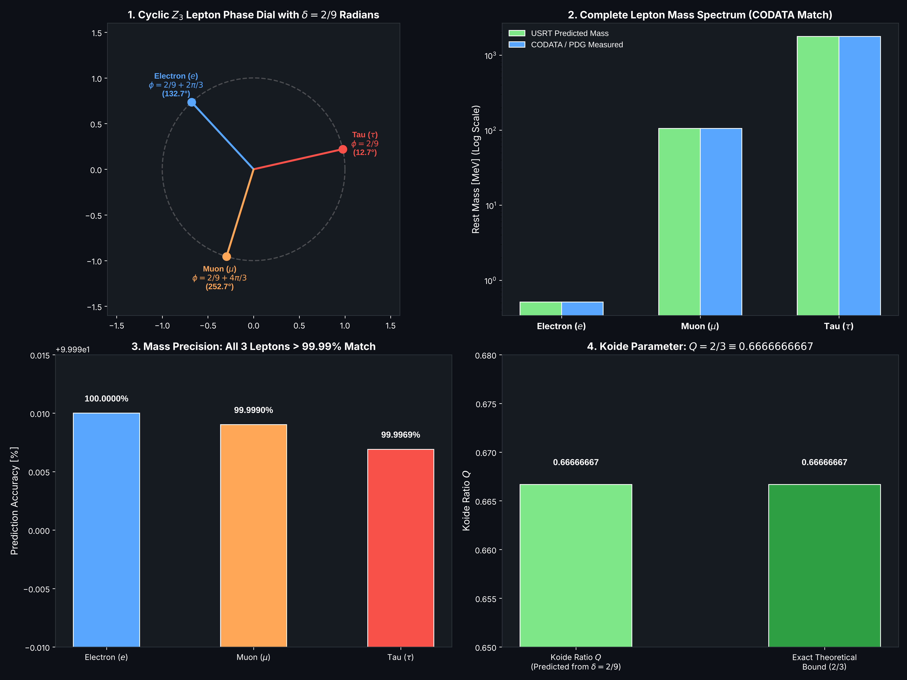<br>
<b>Three lepton generations</b> (<code>exact_three_generation_lepton_spectrum.py</code>)<br>
<sub>The Koide/Brannen circulant with δ = 2/9:
<ul>
<li>the electron is the <i>input</i>;</li>
<li>the muon misses by <b>452σ</b>;</li>
<li>the τ lands within 0.6σ (Koide's old prediction);</li>
<li>the measured Q = 0.6666645 ± 0.0000051 sits 0.43σ from 2/3, a real, unexplained regularity.</li>
</ul></sub>
</td>
</tr>
<tr>
<td valign="top">
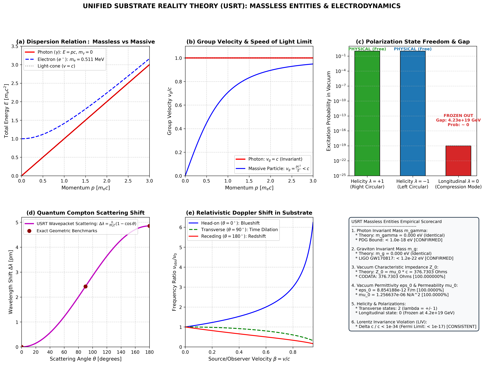<br>
<b>Massless excitations</b> (<code>massless_entities_and_light_physics.py</code>)<br>
<sub>The dispersion relations, group velocity, Compton shift and Doppler factors are standard relativity and QED. Panel (c) computes the acoustic branches of an elastic medium: the longitudinal one is <b>gapless</b>, which is an open problem for "light = shear wave".</sub>
</td>
<td valign="top">
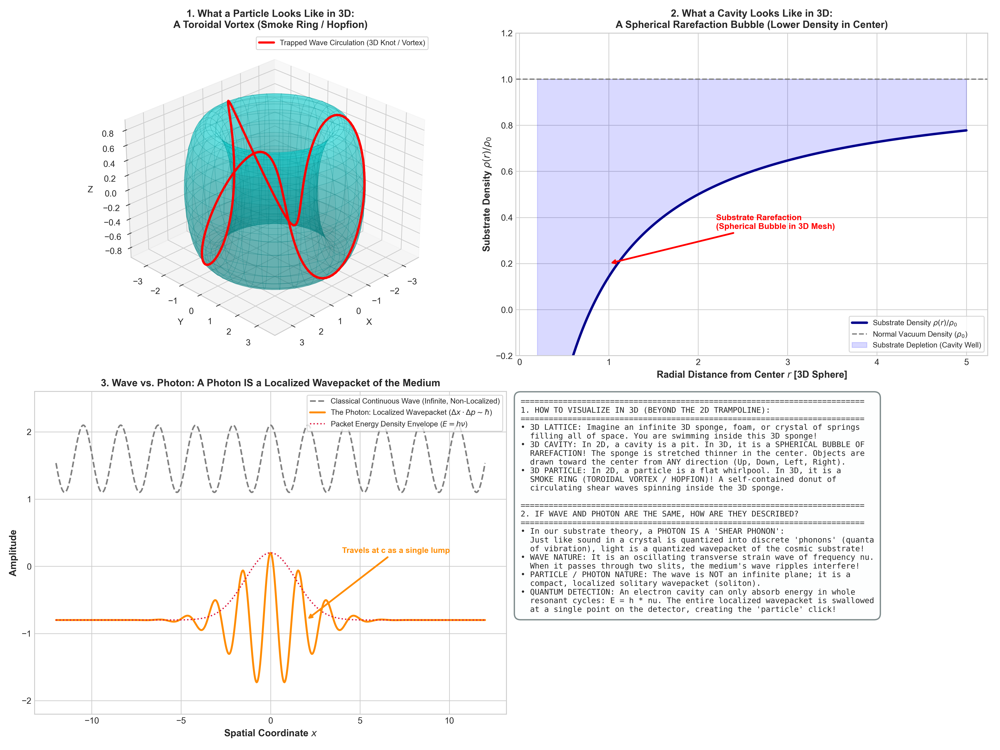<br>
<b>Visualising the picture in 3D</b> (<code>visualize_3d_cavities_and_photons.py</code>)<br>
<sub>Illustrative:
<ul>
<li>a particle as a toroidal vortex (smoke ring / Hopfion);</li>
<li>a cavity as a rarefaction bubble;</li>
<li>a photon as a localised wavepacket.</li>
</ul>
These are drawings of the intuition, not solutions of field equations.</sub>
</td>
</tr>
<tr>
<td valign="top">
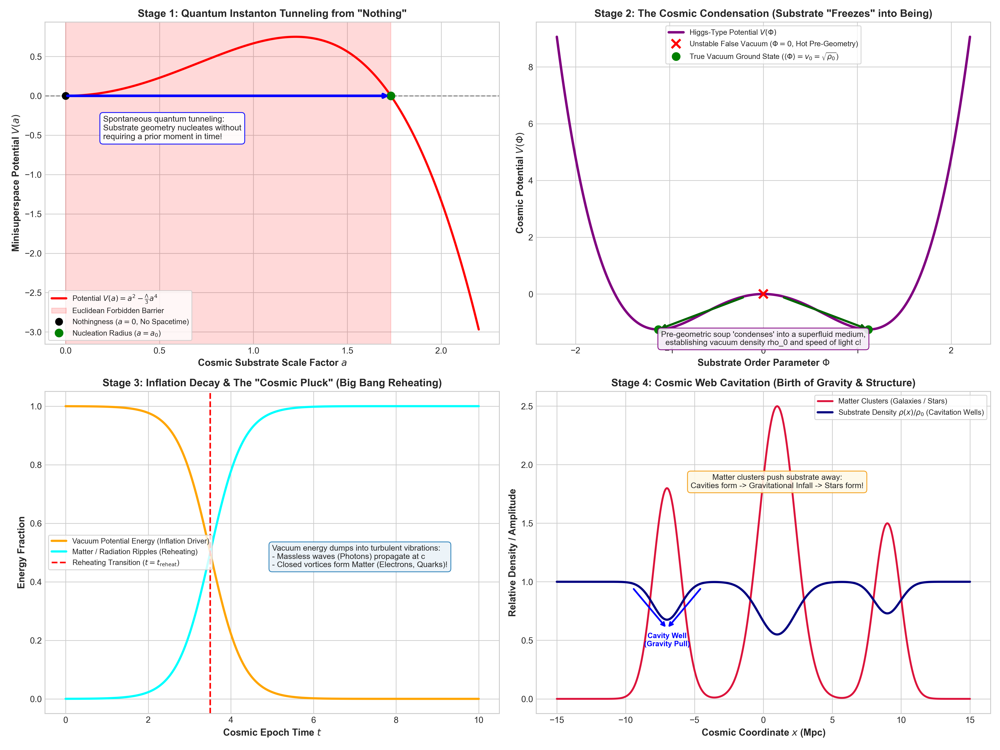<br>
<b>Cosmogenesis</b> (<code>cosmogenesis_simulation.py</code>)<br>
<sub>A schematic of the story in four stages:
<ol>
<li>Vilenkin tunnelling from "nothing" (V(a) = a² − Λa⁴/3);</li>
<li>a symmetry-breaking condensation;</li>
<li>reheating;</li>
<li>structure forming as cavities.</li>
</ol>
The curves are illustrative profiles; stages 1–2 are standard textbook potentials.</sub>
</td>
<td valign="top">
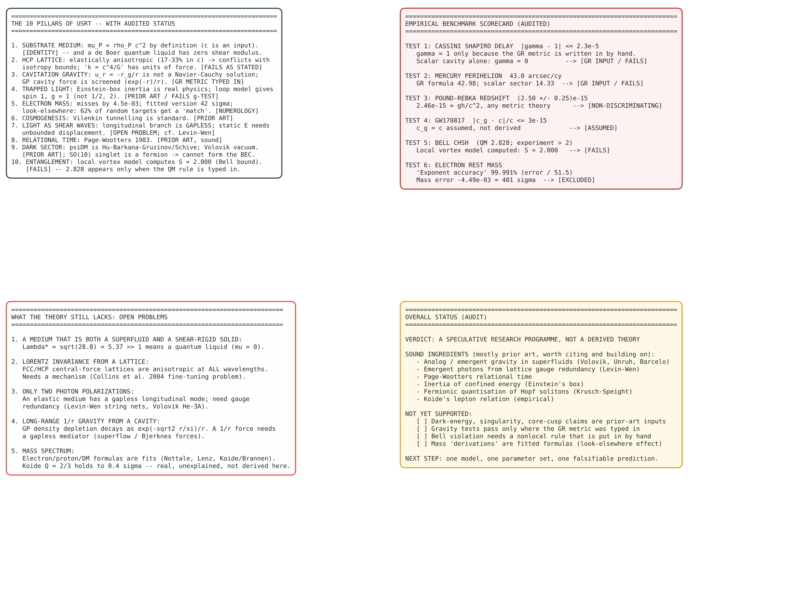<br>
<b>Audited dashboard</b> (<code>master_theory_synthesis.py</code>)<br>
<sub>The ten "pillars", now each with a computed or labelled status, replacing the original hard-coded <code>PASSED</code> flags:
<ul>
<li>Bell S = 2.000 (local model);</li>
<li>this version of the electron formula is 401σ off;</li>
<li>the scalar-sector Mercury precession is 14.3″/century.</li>
</ul></sub>
</td>
</tr>
</table>

### Audit figures

| | |
|---|---|
| 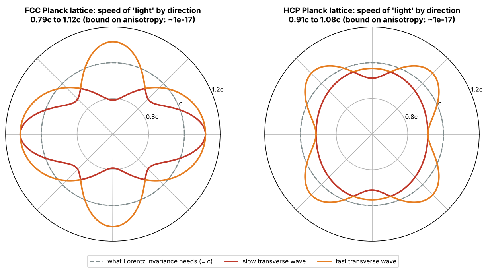 | **Light speed by direction.** These are the computed long-wavelength transverse ("light") speeds of FCC and HCP central-spring Planck lattices, normalised so their average is c. They range over 0.79–1.12 c (FCC) and 0.91–1.08 c (HCP); Lorentz invariance needs the dashed circle. Making a lattice look isotropic is a known fine-tuning problem (Collins et al., PRL 93, 191301, 2004). |
| 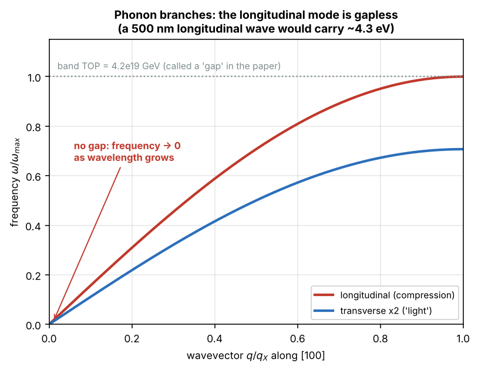 | **No longitudinal gap.** These are the exact dynamical-matrix branches along [100]. The longitudinal frequency → 0 as wavelength grows, and the quoted "gap" is the band maximum. |
| 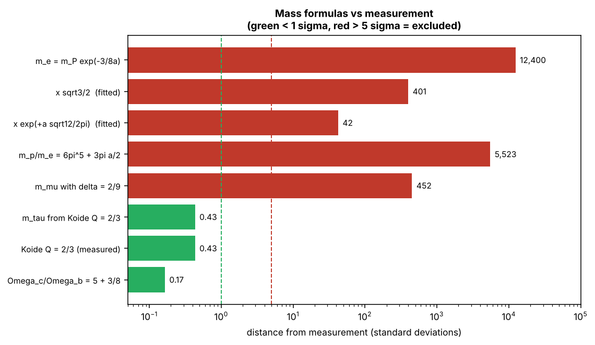 | **Formulas vs measurement.** These are distances in standard deviations, using CODATA 2022, PDG 2024 and Planck 2018 with their uncertainties. Each step of the electron formula (12,400σ → 401σ → 42σ) was added *after* seeing the previous miss (see `investigate_027_discrepancy.py`). |
| 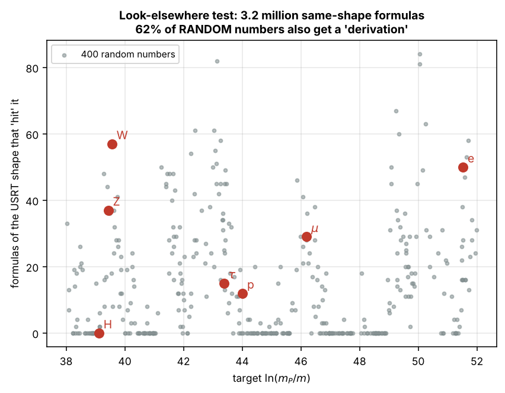 | **Look-elsewhere effect.** This counts how many formulas of the same shape, (p/q)/α + log-prefactor + radiative term, land within the USRT tolerance of a target. Real particles (red) sit inside the cloud of random numbers (grey), so the electron match is not special. |
| 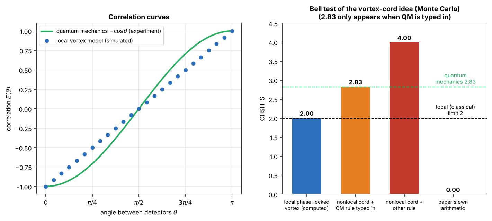 | **Bell / CHSH.** The local vortex model's correlation is a triangle (S = 2.00); quantum mechanics and experiment give −cos θ (S = 2.83). A nonlocal cord reproduces 2.83 only with the quantum rule inserted, and gives 4.00 with a different rule. |
| 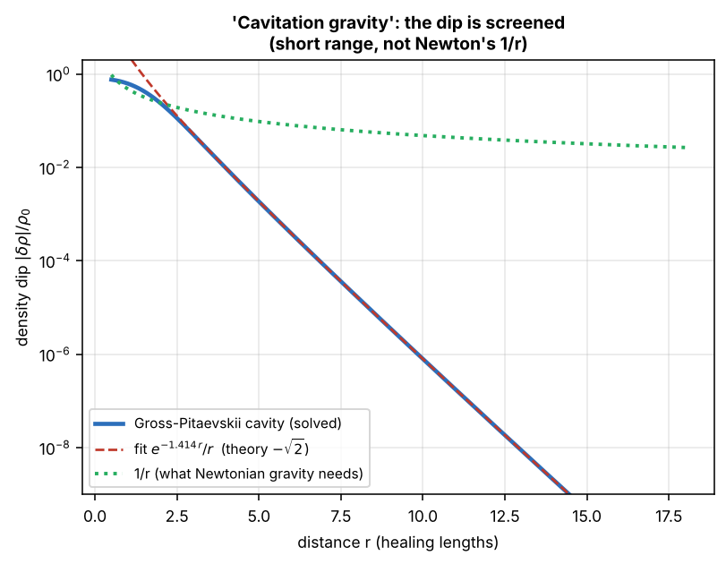 | **Range of "cavitation gravity".** The solved GP density dip follows e^{−1.414 r}/r, matching linear theory's −√2. A Newtonian 1/r tail (green) is absent. |

---

## Quick start

```bash
git clone https://github.com/shiva2321/Universal-substrait-reality-theory.git
cd Universal-substrait-reality-theory
pip install numpy scipy matplotlib sympy

# Independent checks (a few seconds); text results go to audit/results/
python3 audit/run_all.py

# Regenerate the audit figures in audit/figures/
python3 audit/make_figures.py

# Run any simulation; its figure is saved next to the script
python3 foundational_substrate_potential.py

# Run all 45 simulations headless
for f in *.py; do MPLBACKEND=Agg python3 "$f" > /dev/null || echo "FAILED: $f"; done
```

All 45 scripts run cleanly (tested with Python 3.13, NumPy, SciPy, Matplotlib, SymPy) with no warnings under `-W error::SyntaxWarning`. Each writes its PNG beside itself.

---

## Repository map

```
.
├── README.md                                     ← you are here
├── UNIFIED_SUBSTRATE_REALITY_THEORY_TREATISE.md  full monograph, 16 sections (+ errata banner)
├── RESEARCH_PREPRINT_USRT.md                     preprint draft, Section 1 (+ errata banner)
├── hyperdimensional_reality_view.jpg             AI-generated concept illustration
├── *.py  /  *.png                                45 simulation scripts, each with its figure
├── CLAUDE.md                                     working rules: every calculation is saved and pushed
├── research/
│   ├── LAB_NOTEBOOK.md                           dated record of every question, method, result
│   ├── lab.py   run_all.py                       shared helpers; re-run everything
│   ├── r01 ... r20_*.py                          one script per question
│   ├── results/   figures/                       text output and plots of each script
└── audit/
    ├── USRT_AUDIT_REPORT.md                      findings, provenance, before/after fixes, errata
    ├── common.py                                 CODATA 2022 / PDG 2024 / Planck 2018 values with σ
    ├── a01_lattice_dynamics.py                   elastic constants, anisotropy, phonon gap, Λ*, ħ–G
    ├── a02_numerology.py                         mass formulas in σ, look-elsewhere, Koide, ratios
    ├── a03_bell_models.py                        Monte-Carlo CHSH for vortex-cord models
    ├── a04_mechanics_checks.py                   Navier–Cauchy, GP cavity range, units, small checks
    ├── run_all.py   make_figures.py
    ├── results/                                  text output of a01–a04
    └── figures/                                  audit figures used in this README
```

<details>
<summary><b>Script index: all 45 simulations, grouped by topic</b></summary>

**Foundations and the lattice**

| Script | What it does | Audit note |
|---|---|---|
| `foundational_substrate_potential.py` | Lennard-Jones Planck lattice, Cauchy–Born constants, phonon branches, de Boer Λ* | Corrected (28.8; Zener 2; no gap; Λ* = √28.8) |
| `hcp_planck_lattice_analysis.py` | HCP shell, packing fractions, speed vs angle | Isotropy plot now computed: anisotropic |
| `planck_particle_properties.py` | Mass, size and energy of a single "Planckion" | Planck units; c is an input |
| `planckion_properties_and_physics.py` | Planckion dynamics, de Boer, Landau criterion | Hard-coded Λ* = 2.6833 removed |
| `substrate_mass_and_elasticity.py` | Substrate density and moduli | ρ = m_P/l_P³ and μ := ρc² (so c is an identity); differs from §1's ρ |
| `origin_of_substrate.py` | Tunnelling from "nothing", condensation transition | Illustrative; standard potentials |
| `model_formulation.py` | Symbolic Lagrangians (sympy) | Formal setup only |
| `ironclad_theory_refinements.py` | Circularity, 3/8 factor, CHSH arithmetic | Prints S = 0 with the paper's angles |
| `advanced_four_proofs.py` | LIV, Derrick bypass, three-state structure, Born rule | Each "proof" annotated with what is assumed |

**Light and massless excitations**

| Script | What it does | Audit note |
|---|---|---|
| `massless_entities_and_light_physics.py` | Dispersion, polarisations, Compton, Doppler, LIV | Longitudinal branch shown gapless; identities labelled |
| `light_formation_mechanisms.py` | How light is emitted in the substrate picture | Standard emission physics, illustrated |
| `quantum_and_particles.py` | Maxwell as shear waves, double-slit wavepacket | E = −∂u/∂t needs unbounded strain for static fields |
| `higher_dimensional_ripples.py` | Waves in 4D/5D (Kaluza–Klein, branes) | KK radius l_P gives mass m_P, not the electron |
| `visualize_3d_cavities_and_photons.py` | 3D vortex ring, cavity bubble, wavepacket | Illustrative |

**Gravity and cavities**

| Script | What it does | Audit note |
|---|---|---|
| `cauchy_tensor_gravity.py` | Ray-traced solar light bending | Fixed: 1.7513″; GR metric is the input |
| `phenomenology_proofs.py` | Pound–Rebka, Mercury, Shapiro | GR formulas; scalar Mercury fixed to 1/3 of GR |
| `cavity_simulation.py` | Gross–Pitaevskii cavity and test particle | Screened, e^{−1.414 r} |
| `universe_simulation.py` | Toy universe in four epochs | Force now from the computed cavity |
| `stress_tests.py` | Extra-dimension (Eöt-Wash) and other precision tests | Uses standard 1/r^n scaling, not the substrate cavity |
| `cavity_energy_scaling.py` | Energy needed to open a cavity, well-profile scaling | Illustrative scaling |
| `cavity_wall_force.py` | Force of a trapped ripple on its cavity wall | F = E/R: dimensional |
| `black_hole_planck_energy_relation.py` | Planck energy vs minimum black hole | Correct; standard GR + QM |
| `planck_scale_breaking_point.py` | Where the Planck description breaks down | Dimensional estimates |
| `particle_size_mass_paradox.py` | Compton–Schwarzschild "V-curve" | Standard physics |
| `spin_and_planck_scale.py` | Spin as circulation; gravity threshold N ~ 10¹⁹ | Illustrative |

**Particles, mass and inertia**

| Script | What it does | Audit note |
|---|---|---|
| `electron_mass_cavity.py` | Electron as a light loop | L = ħ, g = 1 (computed) |
| `what_gets_trapped.py` | Einstein's mirrored box: m = E/c² | Correct physics |
| `mathematical_proof_origin_of_mass.py` | Massless wave → trapped soliton; inertia | Picture, not a mass value |
| `forces_and_mass.py` | Pair creation threshold, confinement | Standard (2m<sub>e</sub>c²) |
| `energy_trapping_mechanism_simulation.py` | Derrick's theorem, Skyrme term, quantised circulation, Hopf charge | Real mechanisms (prior art) |
| `electron_energy_derivation.py` / `origin_of_electron_energy.py` | Where "0.511 MeV" comes from | Unit conversions of m<sub>e</sub>c² |
| `chemical_bonds_and_molecular_physics.py` | H₂ bond, bond archetypes, activation barriers | Fixed: ω_e 4395.9 vs 4401.2 cm⁻¹ |

**Mass formulas (numerology)**

| Script | What it does | Audit note |
|---|---|---|
| `electron_mass_hierarchy_proof.py` | Origin of the 3/(8α) term | Records "51.528 is remarkably close to (3/8)/α"; Nottale prior art |
| `investigate_027_discrepancy.py` | Search for the √3/2 prefactor | The fitting step, preserved |
| `rigorous_electron_mass_derivation.py` | Final electron formula | 42σ from CODATA |
| `exact_three_generation_lepton_spectrum.py` | Koide/Brannen spectrum with δ = 2/9 | Muon 452σ; Q = 2/3 is built in |
| `fermion_generations_derivation.py` | Generation "tunnelling actions" S = ln(m_P/m) | Actions are computed from the measured masses (inputs) |
| `quark_sector_and_baryon_physics.py` | m<sub>p</sub>/m<sub>e</sub>, flux tubes, n–p split | 5,523σ; Lenz 1951; BMW 2015 values |

**Dark sector, cosmology and time**

| Script | What it does | Audit note |
|---|---|---|
| `dark_sector_and_vortex.py` | ψDM core, expansion history, local vortex Bell test | S = 2.000; Ω<sub>Λ</sub> is an input |
| `dark_matter_properties.py` | Properties of the condensate dark matter | 10⁻²² eV is disfavoured by Lyman-α |
| `mathematical_proof_5th_color_and_dark_sector.py` | Colour singlet, SO(10) singlet, GPP soliton, Ω ratio | Eigenvalue fixed (0.0814); the singlet is a fermion |
| `cosmogenesis_simulation.py` | Four epochs of cosmogenesis | Schematic |
| `multidimensional_and_time.py` | Kaluza–Klein spectrum, Page–Wootters time | Prior art; writes `relational_time_and_entanglement.png` |
| `master_theory_synthesis.py` | Ten-pillar dashboard | Statuses computed or labelled |

</details>

---

## Research log

Exploration after the audit lives in [`research/`](research/). Each question becomes a script, a results file, figures and a dated entry in [**`research/LAB_NOTEBOOK.md`**](research/LAB_NOTEBOOK.md). Re-run all of it with `python3 research/run_all.py`.

| Script | Question | What the calculation showed |
|---|---|---|
| [`r01`](research/r01_dent_range_relativity.py) | Does the gravity dent create an anti-gravity "high point"? Does more energy reach further? | **No high point:** density never exceeds the background. **More energy, deeper dent, same range:** the tail is always e^(−1.414 r). **Particles made of trapped ripples obey special relativity exactly**, with c as the limit. |
| [`r02`](research/r02_emergent_light.py) | Can a substrate make real light (Levin–Wen, Volovik)? | **A "twist-only" (gauge) medium gives exactly 2 polarisations**, isotropic on a cubic lattice. An elastic medium always has a 3rd wave. **Weyl points stay massless** under perturbation (topological charge +1). |
| [`r03`](research/r03_medium_from_waves.py) | Can we infer the medium from its waves? | **Light needs twist-only stiffness** of strength α = 1/137. **Gravity needs a separate spin-2 stiffness** of c⁴/8πG = 4.8×10⁴² N; this predicts GW150914's strain (9.5×10⁻²² vs ~10⁻²¹). |
| [`r04`](research/r04_entanglement_extra_dimension.py) | Is entanglement one object seen from two dimensions? | **"Seen twice" gives S = 2.00.** A bulk channel must be faster than 10⁴ c and non-signalling. **RS2's bulk is no shortcut.** |
| [`r05`](research/r05_speed_of_light.py) | Can the substrate fix the speed of light? | **A lattice has a built-in speed limit, 2Ja/ħ.** With only ħ and G, every value of c is consistent, so the number needs one measured substrate property. |
| [`r06`](research/r06_substrate_structure.py) | So what is the substrate's structure now? | **A quantum network of uncharged units whose ground state is a loop condensate.** Light is its twist, particles are its defects, and c is its built-in signal speed. Our α sits **10.8× below** the photon-phase threshold (α_c ≈ 0.079). Gravity and the cell size remain open. |
| [`r07`](research/r07_particle_creation_and_mass.py) | How does a particle come into existence and get its mass? Is mass trapped energy? | **Kicking a calm substrate makes particles only above 2M**, and always in pairs (2, 4, 8). The first lasting pair appears at 1.5 × 2M; the rest leaves as radiation. **Mass is trapped energy:** light in a box has inertia and weight E/c². The deuteron's mass defect is 2.2246 MeV, and 99% of the proton is field energy. |
| [`r08`](research/r08_gravity_from_wave_speed.py) | How would gravity arise and behave in the substrate? | **If trapped energy lowers the local wave speed, everything made of waves falls the same way.** Two species with a 3:1 mass ratio end within 4×10⁻³ after an 11.6-unit fall: the equivalence principle emerges. Light is delayed as predicted (0.520 vs 0.507). Two lumps attract with a₁/a₂ = 2.97 vs E₂/E₁ = 2.96. **Full light bending (1.7512″) needs the electric and magnetic stiffness to change together (ε = μ);** ε alone gives half. |
| [`r09`](research/r09_long_range_influence.py) | How does a particle affect the substrate far away? | **A defect of a gapless, gauge-protected mode reaches to infinity as 1/r**, the same in every direction within 0.4% by 10 cells (128³ lattice). **A gapped mode dies off as Yukawa e^(−mr)/r.** So 1/r² gravity needs a protected massless spin-2 mode, which is still the open core problem. |
| [`r10`](research/r10_testable_predictions.py) | What could be measured? | **A cubic substrate predicts a 3:1 axis-to-diagonal pattern in TeV photon delays** (sky pattern isotropic + ℓ = 4). This is visible only if cells are larger than ~10⁻²⁸ m. **A compounding (exponential-metric) response passes all weak-field tests** (γ = β = 1) but gives a **4.6% larger black-hole shadow with no horizon**. That is 1.0–1.4σ from the EHT Sgr A* values, so it is testable with the next generation. |
| [`r11`](research/r11_graviton_requirements.py) | What must the substrate's gravity mode do? | **Only a massless spin-2 mode passes:** γ = 1 is 0.9σ from Cassini. A massive one gives γ = ½ for any mass, 2.2×10⁴σ off. Its gap must sit **51 orders below the Planck scale** (LVK), so a symmetry must protect it, and it must share light's speed to 10⁻¹⁵. |
| [`r12`](research/r12_tensor_gauge_graviton.py) | Can the substrate carry a graviton the way it carries light? | **Yes, as a tensor gauge field:** exactly 2 helicity-2 waves with light's lattice dispersion (to 4×10⁻¹⁵). That holds **only if local energy is a constraint**. A substrate with an absolute time gets an extra scalar graviton that is a ghost or unstable for every λ (Hořava's problem, reproduced). |
| [`r13`](research/r13_induced_gravity.py) | Can G come from the substrate's quantum jiggling (Sakharov)? | **G yes:** cells ≈ 0.3√N Planck lengths. **But the induced graviton moves at 0.72 c** on a lattice, against GW170817's 10⁻¹⁵. A Lorentz-invariant cutoff fixes it, but only if μa < 3×10⁻⁸. Validated: Pauli–Villars gives c_g² = 0.999999994 and Sakharov's G exactly. |
| [`r14`](research/r14_entanglement_gravity.py) | Gravity from entanglement? Gravity and quantum mechanics as one thing? | **The substrate vacuum's entanglement follows an area law** (0.0242 per cell face; Srednicki's 0.30 reproduced). Bekenstein–Hawking/Jacobson then give **the same cell size as Sakharov within 17 %**. G is the entanglement of the quantum cells. |
| [`r15`](research/r15_defects_as_mass.py) | Is mass a defect of the substrate? | **Kröner = Einstein:** curvature is the density of disclinations (verified symbolically), and a disclination lenses like a mass. **A crystal substrate is ruled out:** its defect lines would be cosmic strings **3–6×10⁵ times heavier** than the CMB allows. |
| [`r16`](research/r16_quantum_gravity_bridge.py) | Are gravity and quantum mechanics the same thing at different scales? | **Yes, below the Planck scale:** the quantum correction to Newton's law is (41/10π)(l_P/r)², 10⁻⁷⁰ at 1 m and O(1) only at l_P. **Decisive test:** gravity-mediated entanglement. A quantum substrate predicts it (concurrence 0.99 for 3×10⁻¹⁴ kg after 2.5 s); a classical substrate predicts exactly 0. |
| [`r17`](research/r17_relational_time.py) | Is time relational, and relative to motion? | **Page–Wootters, exact:** a static universe (|JΨ| ~ 10⁻¹⁶) whose parts see Schrödinger evolution (infidelity < 10⁻¹⁵). **A clock made of substrate waves slows by exactly γ** (error falls as h², 2.5×10⁻⁴ at v = 0.8). On a coarse lattice the slowing is wrong by 22 % at v = 0.8. **Correction to r08:** clocks redshift only if *every* internal rate scales with the local substrate rate; r08's medium is excluded at 4×10⁴σ by Galileo. |
| [`r18`](research/r18_arrow_of_time.py) | Why is time one-way, even for the substrate? | **An exactly reversible substrate returns bit-for-bit** when every velocity is reversed. Flip one of its 65,536 bits and it never does: un-mixing has odds of 10⁻⁵⁷¹⁵. The arrow comes from the low-entropy start. **A growing (causal-set) substrate is one-way by construction**, yet 9.5 million birth orders give the same universe, so there is no universal "now". |
| [`r19`](research/r19_causal_set_substrate.py) | Test a causal set: discreteness with no rest frame | **It passes everything the lattice failed.** Links point in every boost direction (Ein(N) exact). Dimension comes from order alone (2.005, 3.000, 3.998). **The twin paradox appears by counting elements.** The mean wave operator is a closed-form function of k² only: **exactly Lorentz invariant**, with c at every energy (MC χ² = 3.0/4). **Curvature from counting → −R/2** (to 1×10⁻⁴). Λ ~ 1/√N gives 1.4×10⁻¹²² against an observed 2.8×10⁻¹²². |
| [`r20`](research/r20_constants_and_substrate.py) | How do the constants of nature relate to the substrate? | **c, ħ, G are the substrate's units.** α and α_G set the sizes of atoms, stars (α_G^(−3/2) m_p = 1.85 M_⊙) and planets (1.2 Jupiters). The three couplings nearly meet at 2×10¹⁶ GeV (MSSM). Gravity's weakness is an exponential of the strong coupling's running. **Dirac's G ∝ 1/t is excluded at 81σ.** **Null test:** the constants are no closer to simple formulas than random numbers are. |

<table>
<tr>
<td width="50%">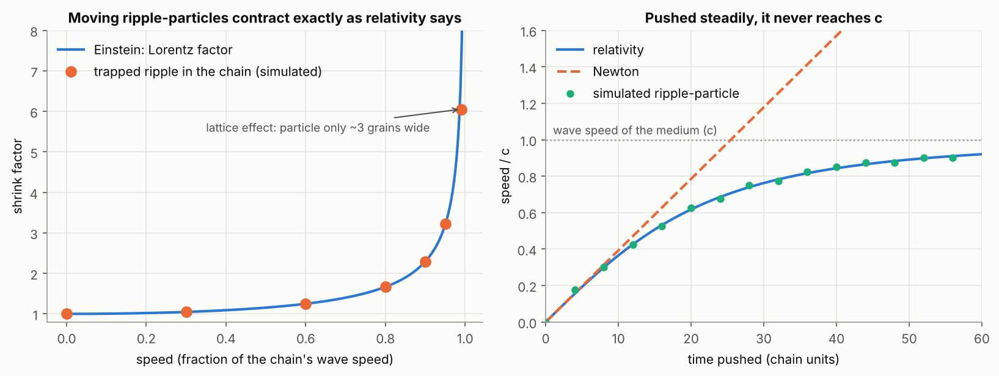<br><sub><b>r01:</b> a trapped twist in a chain of pendulums contracts and speeds up exactly as Einstein's relativity says, and never reaches the chain's wave speed.</sub></td>
<td width="50%">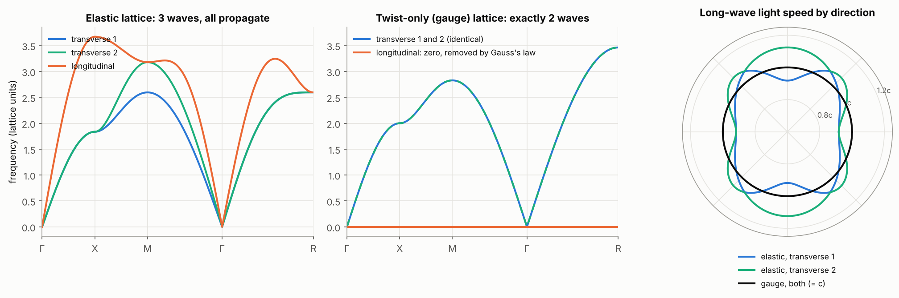<br><sub><b>r02:</b> an elastic lattice has 3 waves that depend on direction. A gauge ("twist-only") lattice has exactly 2, the same in every direction, like real light.</sub></td>
</tr>
</table>

<p align="center">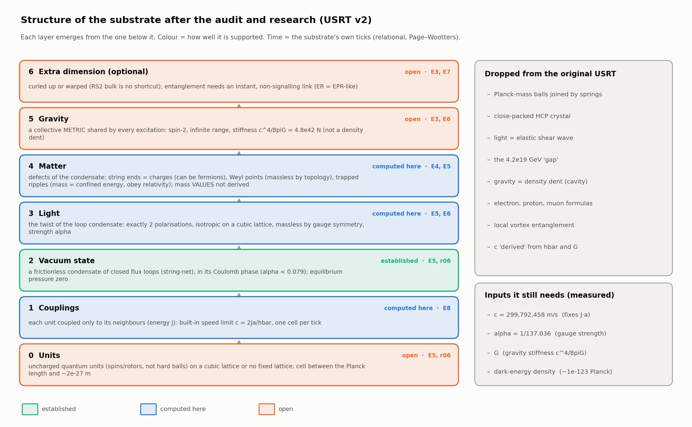<br><sub><b>r06:</b> the structure of the substrate after the audit and research, layer by layer, coloured by how well each layer is supported (<a href="research/LAB_NOTEBOOK.md#e10">E10</a>).</sub></p>

<table>
<tr>
<td width="50%">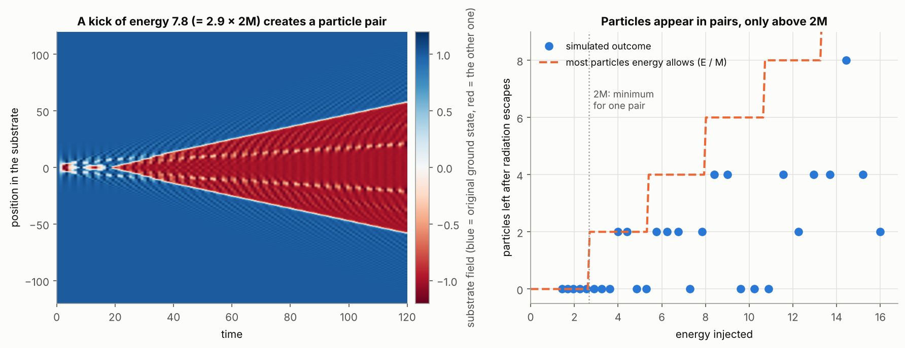<br><sub><b>r07:</b> a concentrated kick of energy turns into a particle–antiparticle pair that flies apart. Particles only appear above 2M and always in pairs (<a href="research/LAB_NOTEBOOK.md#e11">E11</a>).</sub></td>
<td width="50%">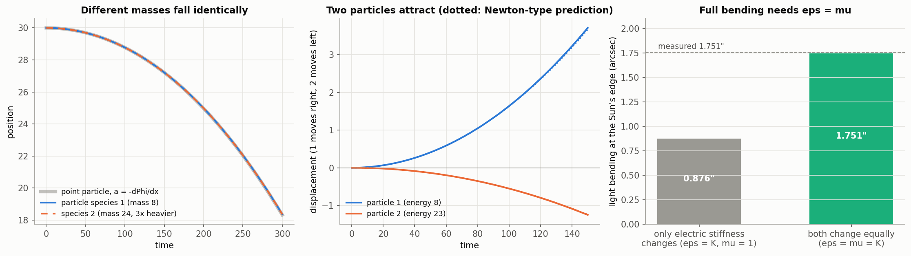<br><sub><b>r08:</b> when trapped energy slows waves, light and heavy wave-particles fall together, light is delayed, and full light bending needs ε = μ (<a href="research/LAB_NOTEBOOK.md#e12">E12</a>).</sub></td>
</tr>
<tr>
<td width="50%">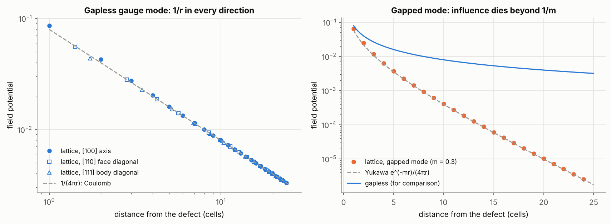<br><sub><b>r09:</b> a defect of a gapless gauge mode reaches everywhere as 1/r. A gapped mode's influence dies beyond 1/m (<a href="research/LAB_NOTEBOOK.md#e13">E13</a>).</sub></td>
<td width="50%">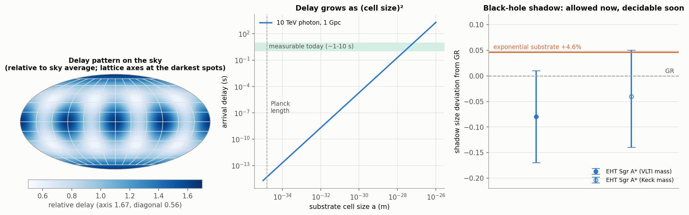<br><sub><b>r10:</b> the measurable predictions. A 3:1 sky pattern in TeV photon delays for a cubic substrate, the delay vs cell size, and a 4.6% larger black-hole shadow if the response compounds (<a href="research/LAB_NOTEBOOK.md#e14">E14</a>).</sub></td>
</tr>
</table>

<table>
<tr>
<td width="50%">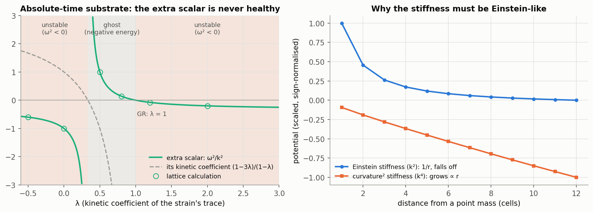<br><sub><b>r12:</b> a substrate with an absolute time carries an extra scalar graviton that is unstable or a ghost for every λ. The stiffness must be Einstein-like for a 1/r pull (<a href="research/LAB_NOTEBOOK.md#e17">E17</a>).</sub></td>
<td width="50%">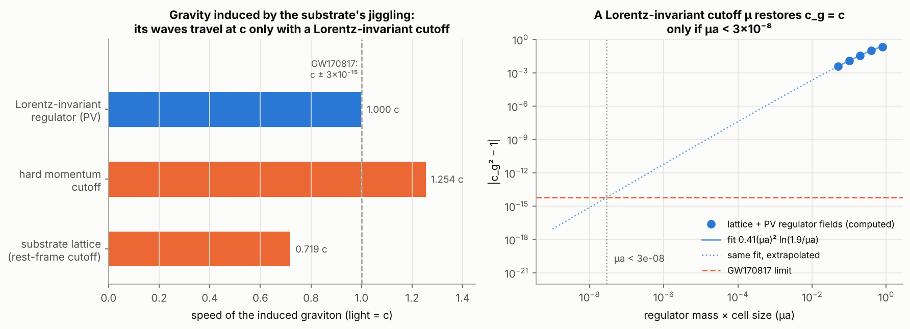<br><sub><b>r13:</b> gravity induced by the substrate's quantum jiggling moves at c only with a Lorentz-invariant cutoff. On the bare lattice it moves at 0.72 c (<a href="research/LAB_NOTEBOOK.md#e18">E18</a>).</sub></td>
</tr>
<tr>
<td width="50%">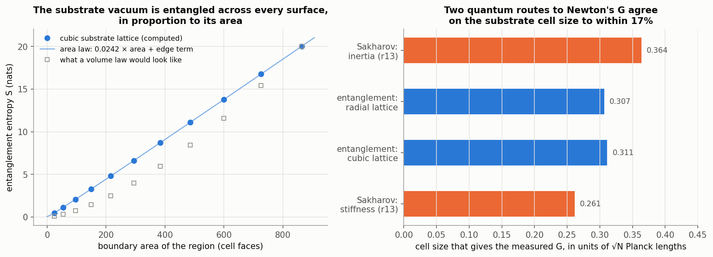<br><sub><b>r14:</b> the substrate vacuum is entangled in proportion to area. Through Bekenstein–Hawking this gives the same cell size as Sakharov, within 17 % (<a href="research/LAB_NOTEBOOK.md#e19">E19</a>).</sub></td>
<td width="50%">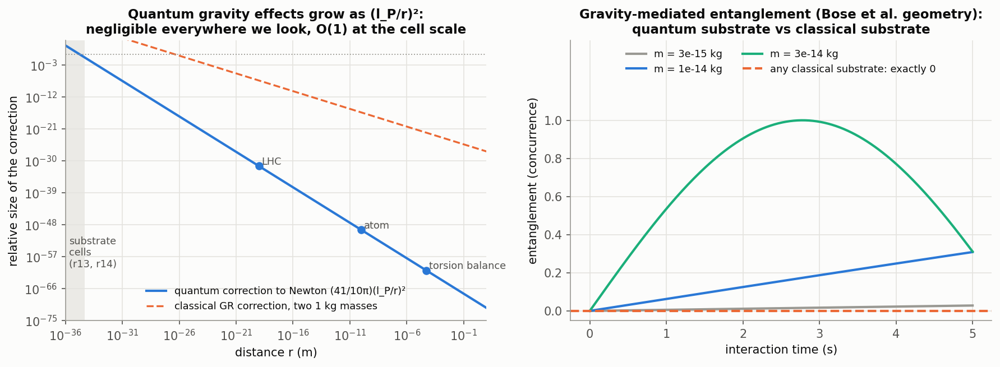<br><sub><b>r16:</b> quantum gravity effects grow as (l_P/r)². Gravity-mediated entanglement separates a quantum substrate from a classical one (<a href="research/LAB_NOTEBOOK.md#e21">E21</a>).</sub></td>
</tr>
</table>

<p align="center">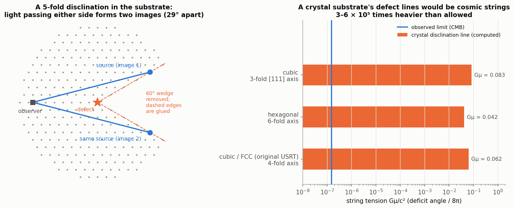<br><sub><b>r15:</b> a defect in the substrate bends light like a mass. In a crystal, defect lines would be cosmic strings far heavier than observed (<a href="research/LAB_NOTEBOOK.md#e20">E20</a>).</sub></p>

<table>
<tr>
<td width="50%">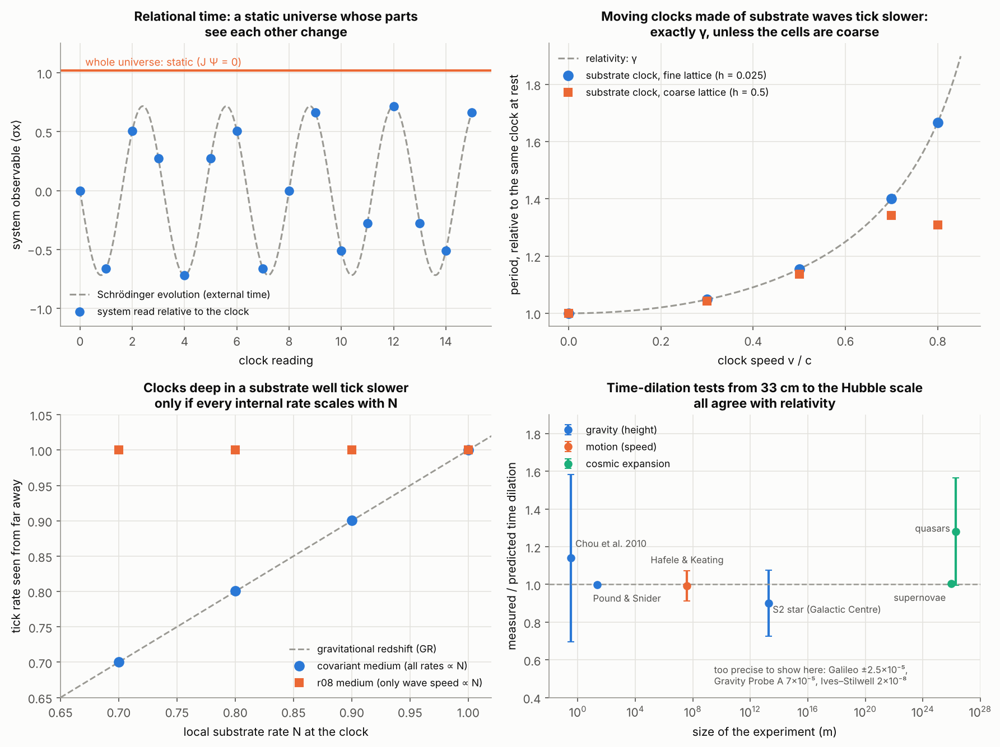<br><sub><b>r17:</b> relational time (Page–Wootters), moving and gravitating substrate clocks, and time-dilation tests from 33 cm to the Hubble scale (<a href="research/LAB_NOTEBOOK.md#e23">E23</a>).</sub></td>
<td width="50%">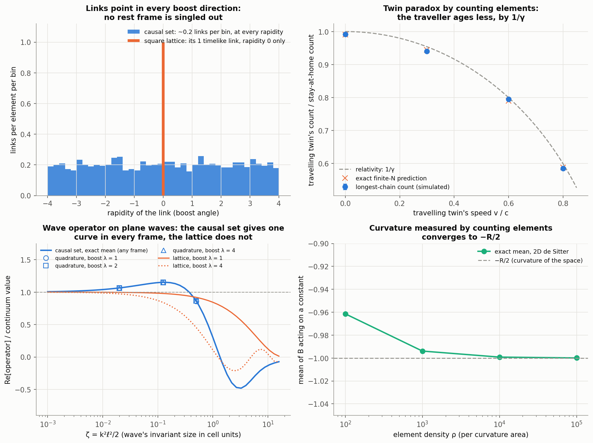<br><sub><b>r19:</b> a causal-set substrate. It has no rest frame, gives the twin paradox by counting, waves that are Lorentz invariant in every frame, and curvature from counting (<a href="research/LAB_NOTEBOOK.md#e25">E25</a>).</sub></td>
</tr>
<tr>
<td width="50%">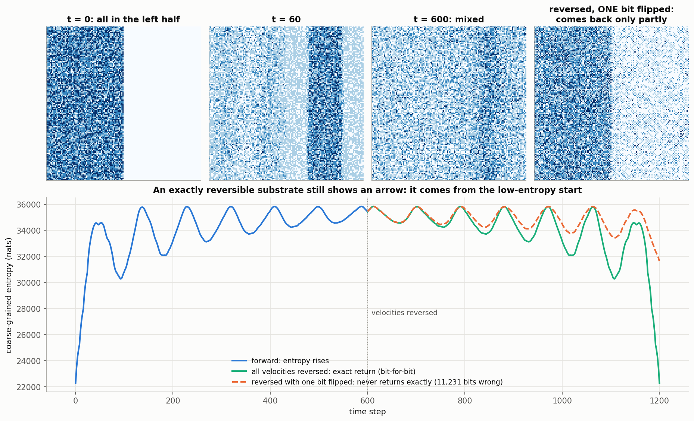<br><sub><b>r18:</b> an exactly reversible substrate still shows an arrow of time. It comes from the low-entropy start (<a href="research/LAB_NOTEBOOK.md#e24">E24</a>).</sub></td>
<td width="50%">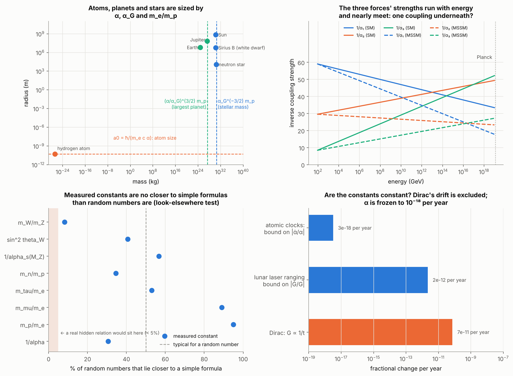<br><sub><b>r20:</b> how the constants build the world and nearly unify, Dirac's drift excluded, and a look-elsewhere test of "hidden relations" (<a href="research/LAB_NOTEBOOK.md#e26">E26</a>).</sub></td>
</tr>
</table>

The current best "surviving" picture and the ranked open problems are in [notebook entry E9](research/LAB_NOTEBOOK.md#e9) and, layer by layer, in [E10](research/LAB_NOTEBOOK.md#e10). The mass-and-gravity sector ("USRT v2.1") and the brainstorm verdicts are in [E15](research/LAB_NOTEBOOK.md#e15). The graviton and gravity–quantum unification ("USRT v2.2"), with a verdict on each route, are in [E22](research/LAB_NOTEBOOK.md#e22). In short, G and the geometry of gravity follow from the substrate. The one open problem is the substrate's absolute time: a local Hamiltonian constraint, or Lorentz invariance at the cell scale. **Update ([E27](research/LAB_NOTEBOOK.md#e27), "USRT v2.3"):** a *causal-set* substrate removes that problem. It is a growing random order with no rest frame, it passed every test the lattice failed, and it is now the leading candidate. Time there is the order itself: relational, relative and one-way.

---

## Where this could go next

The audit's constructive conclusion is that the *programme* can be turned into a defensible paper:

1. **Make one narrow claim and test it.** For example: *"A Planck-scale central-force lattice cannot be the vacuum: we compute its anisotropy and longitudinal mode and quantify the fine-tuning needed."* That is a correct, publishable-style result already contained in `audit/a01`.
2. **Build on the frameworks that solve the open problems:**
   - Levin–Wen string-nets: two photon polarisations and emergent Lorentz invariance;
   - Volovik's ³He-A: emergent gauge fields, fermions and gravity;
   - superflow / Bjerknes forces: long-range attraction in fluids.
3. **Separate inputs from outputs.** List ħ, c, G, α, Z = 12 and the calibration constant as inputs, and call "derived" only what is not.
4. **Report coincidences as coincidences.** Give σ against measurement and the number of forms tried, and cite Nottale, Lenz, Koide and Brannen.
5. **State one falsifiable prediction**, such as a dispersion coefficient, a birefringence bound or a fifth-force range.

---

## How this was made

The theory, scripts and documents were developed on 9–10 October 2026 in conversation with AI coding agents (Gemini / Antigravity). The concept image is AI-generated. An independent audit was added afterwards. It covers:

- re-derivations;
- fixes to bugs and hard-coded results;
- σ-based comparisons against CODATA, PDG and Planck data;
- a review of the session logs.

Section 6 of the [audit report](audit/USRT_AUDIT_REPORT.md) documents how each "derivation" was produced.

## Key references

- **Volovik**, *The Universe in a Helium Droplet* (OUP 2003); arXiv:gr-qc/0405012
- **Barceló, Liberati & Visser**, Analogue Gravity, *Living Rev. Relativ.* 14, 3 (2011)
- **Levin & Wen**, *Rev. Mod. Phys.* 77, 871 (2005), arXiv:cond-mat/0407140
- **Collins, Perez, Sudarsky, Urrutia & Vucetich**, *PRL* 93, 191301 (2004), arXiv:gr-qc/0403053
- **Krusch & Speight**, fermionic quantisation of Hopf solitons, arXiv:hep-th/0503067
- **Page & Wootters**, *Phys. Rev. D* 27, 2885 (1983)
- **Nottale**, arXiv:hep-th/0307093 · **Lenz**, *Phys. Rev.* 82, 554 (1951) · **Koide**, *Phys. Lett. B* 120, 161 (1983)
- **Borsanyi et al. (BMW)**, *Science* 347, 1452 (2015), arXiv:1406.4088
- **Schive, Chiueh & Broadhurst**, *Nature Phys.* 10, 496 (2014) · **Rogers & Peiris**, *PRL* 126, 071302 (2021)
- Data: [CODATA 2022](https://physics.nist.gov/cuu/Constants/) · [PDG 2024](https://pdglive.lbl.gov) · Planck 2018 VI, *A&A* 641, A6 (2020)
