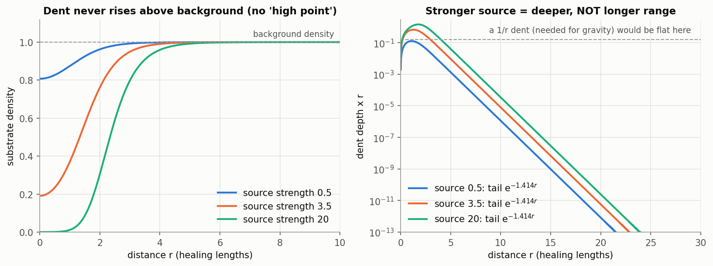
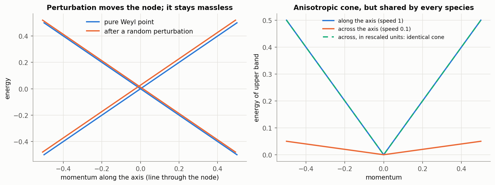
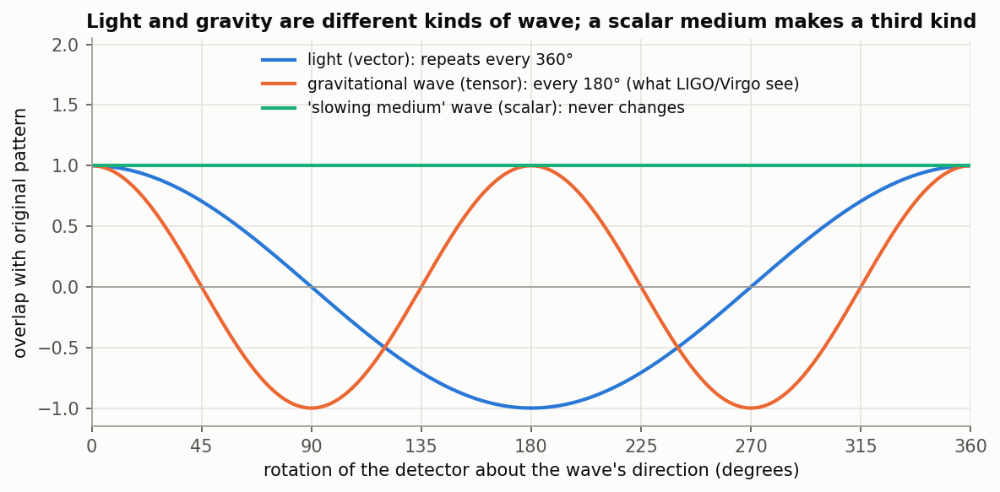
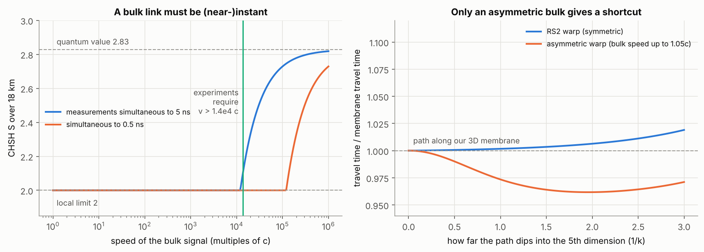
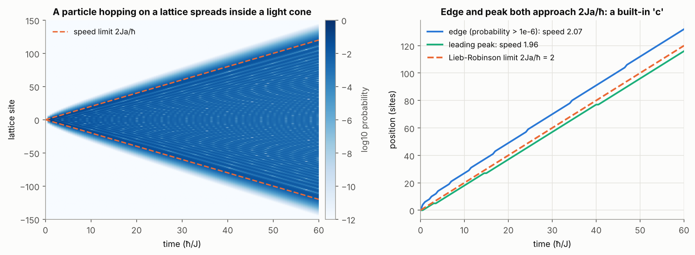
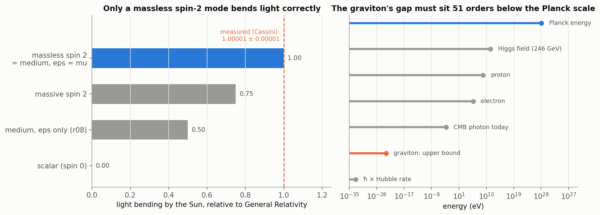
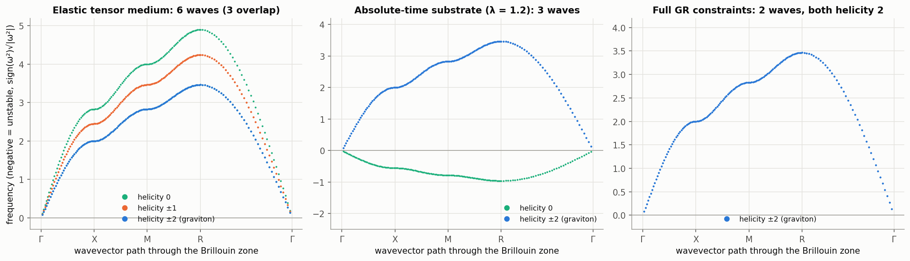
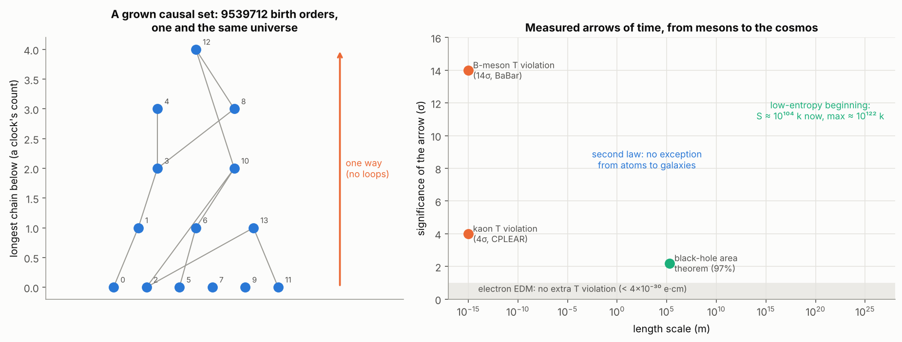

# USRT research lab notebook

This is the running record of every question, calculation, plot and conclusion in the USRT project after the audit. Entries are **appended, never rewritten**. A correction is added as a new dated note under the entry it corrects.

**Conventions**

- Each entry links the script that produced it, its text output in `results/` and its figures in `figures/`.
- Numbers are compared with measurements using their uncertainties.
- Status labels:
  - **established**: textbook or measured physics;
  - **computed here**: our own calculation;
  - **open**: not yet resolved;
  - **ruled out**: contradicted by calculation or experiment.
- To re-run everything: `python3 research/run_all.py` (a few seconds each).

| Entry | Date | Topic | Script |
|---|---|---|---|
| [E0](#e0) | 2026-10-10 | Starting point: what the audit established | `audit/` |
| [E1](#e1) | 2026-10-10 | Does the gravity "dent" create an anti-gravity high point? | r01 |
| [E2](#e2) | 2026-10-10 | Flexible superfluid instead of a crystal; can "interference" slow light? | r01 |
| [E3](#e3) | 2026-10-10 | Does more trapped energy give longer range? Extra dimensions? | r01 |
| [E4](#e4) | 2026-10-10 | Particles as trapped ripples obey relativity (sine-Gordon) | r01 |
| [E5](#e5) | 2026-10-10 | Real light from a substrate: Levin–Wen and Volovik routes | r02 |
| [E6](#e6) | 2026-10-10 | Inverse problem: what the vacuum medium must be, from its waves | r03 |
| [E7](#e7) | 2026-10-10 | Can a higher dimension explain entanglement? | r04 |
| [E8](#e8) | 2026-10-10 | Brainstorm: can the substrate fix the speed of light? | r05 |
| [E9](#e9) | 2026-10-10 | Synthesis: the current best substrate picture and open problems | — |
| [E10](#e10) | 2026-10-10 | The structure of the substrate, layer by layer (USRT v2) | r06 |
| [E11](#e11) | 2026-10-10 | How a particle comes into existence and gets its mass | r07 |
| [E12](#e12) | 2026-10-10 | How gravity could arise: trapped energy lowers the substrate's wave speed | r08 |
| [E13](#e13) | 2026-10-10 | How a particle affects the substrate far away (gapless vs gapped modes) | r09 |
| [E14](#e14) | 2026-10-10 | Measurable predictions: lattice light delays, black-hole shadows | r10 |
| [E15](#e15) | 2026-10-10 | Brainstorm and current formulation: mass and gravity in the substrate | — |
| [E16](#e16) | 2026-10-10 | What measurements demand of the substrate's gravity mode | r11 |
| [E17](#e17) | 2026-10-10 | Building the graviton: tensor-gauge substrate on the lattice | r12 |
| [E18](#e18) | 2026-10-10 | Gravity induced by the substrate's jiggling (Sakharov) and the graviton-speed problem | r13 |
| [E19](#e19) | 2026-10-10 | Gravity from entanglement: area law → Bekenstein–Hawking → G | r14 |
| [E20](#e20) | 2026-10-10 | Mass as a defect of the substrate (world crystal, cosmic strings) | r15 |
| [E21](#e21) | 2026-10-10 | Gravity and quantum mechanics: one thing at different scales? | r16 |
| [E22](#e22) | 2026-10-10 | Synthesis: the graviton and gravity–quantum unification (USRT v2.2) | — |
| [E23](#e23) | 2026-10-11 | Time in the substrate: relational, relative to motion and gravity | r17 |
| [E24](#e24) | 2026-10-11 | The one-way arrow of time at the substrate level | r18 |
| [E25](#e25) | 2026-10-11 | Testing a causal-set substrate: discreteness without a rest frame | r19 |
| [E26](#e26) | 2026-10-11 | The constants of nature and the substrate: how, why and whether they relate | r20 |
| [E27](#e27) | 2026-10-11 | Synthesis: time, the causal-set substrate, and the constants (USRT v2.3) | — |
| [E28](#e28) | 2026-10-11 | Plain-English overview: the journey, the universe according to USRT v2.3, its weaknesses and what it cannot explain | — |

---

## E0 — Starting point (2026-10-10)

The full audit is in [`audit/USRT_AUDIT_REPORT.md`](../audit/USRT_AUDIT_REPORT.md). It established:

- A Planck-scale **crystal** fails two ways:
  - light speed would depend on direction by 17–33 %;
  - its longitudinal wave is gapless (it is not "frozen out").
- The **mass formulas** are fits: electron 42σ, muon 452σ, proton ratio 5,523σ from measurement.
- **Gravity** as written is GR's metric typed in. A superfluid density dent is short-range.
- A **local** vortex picture of entanglement gives S = 2, below the measured values.

What survives:
- the vacuum as a condensed-matter medium;
- the inertia of confined energy;
- fermionic solitons;
- relational time;
- Koide's Q = 2/3 regularity.

---

## E1 — Does the dent create an opposite "high point" (antigravity)? (2026-10-10)

**Question (user):** "Every action has an equal and opposite reaction, so the gravity well should also make a high point. Could that be antigravity?"

**Method:** Solved the radial Gross–Pitaevskii (superfluid) equation around a repulsive source at three strengths (0.5, 3.5, 20, in healing-length units). Searched for any density above the background.

**Result (computed here):**

| Source strength | Centre density | Maximum density anywhere | Tail |
|---|---|---|---|
| 0.5 | 0.807 | 1.000000 | e^(−1.414 r)/r |
| 3.5 | 0.191 | 1.000000 | e^(−1.414 r)/r |
| 20 | 0.000 | 1.000000 | e^(−1.414 r)/r |

The displaced amount (4.7, 28, 82 units) spreads thinly through the rest of the fluid. There is no bump anywhere.

**Interpretation:**
- **Newton's third law is already satisfied.** The reaction is the substrate pushing back on the mass, and that push is what holds the dent open. It does not create a hill elsewhere. A uniform rise in the background exerts no force, because forces come from slopes.
- **Fluids can produce repulsion in other ways** (established):
  - Bjerknes forces: pulsating bubbles attract when in phase and repel when out of phase, both as 1/r²;
  - density rings around impurities, in fluids with a roton minimum such as helium-4.

**Constraints from experiment (established):**
- all matter falls the same way to 1e-15 (MICROSCOPE);
- antimatter falls down (CERN ALPHA-g, 2023);
- gravity follows 1/r² down to about 50 μm, with no alternating rings.

Any repulsive mode therefore must not act on known matter.

**Status:** antigravity from a dent: **ruled out** in this model. Repulsion via out-of-phase pulsation: **open**, but heavily constrained.

**Files:** [`r01_dent_range_relativity.py`](r01_dent_range_relativity.py), [results](results/r01_dent_range_relativity.txt), 

---

## E2 — Flexible superfluid instead of a crystal; can interference slow light? (2026-10-10)

**Question (user):**
- "Rule out the crystal. What about uncharged Planckion-like entities in a flexible superfluid?"
- "If many ripples pile up near concentrated energy, wouldn't their interference slow light down?"

**Results (computed here):**
- **Isotropy: yes.** A fluid has no grain. With Planck-mass grains, the only speed change is that short waves go slightly faster (Bogoliubov dispersion):
  - green light: 5×10⁻⁵⁷;
  - 100 GeV gamma rays: 8×10⁻³⁶;
  - the same in every direction, far below any bound.
- **Wrong kind of wave: problem.** A superfluid carries only compression waves (one polarisation). Light is two transverse polarisations, so a plain superfluid cannot make light. Follow-up in E5.
- **Interference does not change speed.** Waves superpose linearly and pass through each other unchanged. Speed changes only if the medium itself changes. In a superfluid the wave speed rises with density (c ∝ √n), so a **thinner** region slows waves and bends them toward the mass.
- **Size of dent needed to copy GR's light bending exactly:**
  - δρ/ρ = −4GM/(rc²), falling as 1/r;
  - 8.5×10⁻⁶ at the Sun's surface;
  - 2.8×10⁻⁹ at Earth's surface.
- **The effect is real.** Radar grazing the Sun on an Earth–Mars round trip returns **247 μs** late (the Shapiro delay, measured).
- **Smooth, not random.** The slowing must be identical for all colours, because gravitational lensing is achromatic. Random interference would blur images and depend on colour.

**Prior art:** Dicke 1957 and Puthoff's "polarizable vacuum" use exactly this "vacuum slows light" idea. They pass the classic tests but predict scalar gravitational waves (see E6).

**Status:**
- isotropic fluid: **computed here, works**;
- light from a plain fluid: **ruled out**;
- slowing by the medium: **established mechanism, needs a 1/r dent**.

---

## E3 — Bigger trapped energy, longer range? Spreading into extra dimensions? (2026-10-10)

**Question (user):** "The well should extend according to how much energy is trapped, and spread in all directions and dimensions."

**Results (computed here):**
- **More energy makes the dent deeper, not longer-reaching.** The tail decay rate is identical (−1.414) for all three source strengths (E1 figure, right). The range is the medium's healing length ξ = ħ/(√2 m c_s), not a property of the source.
- **Range requirement.** For the dent to reach galaxy scales, the healing length must be at least a kiloparsec, so the grain mass must be ≤ 4.5×10⁻²⁷ eV (10⁻⁵⁵ of the Planck mass). The LIGO graviton-mass bound alone requires ≤ 9×10⁻²⁴ eV. *Planck-mass grains and long-range dents contradict each other.*
- **Spreading in all directions** is Gauss's law, and it is exactly why gravity is 1/r² in 3 dimensions. In D space dimensions the force goes as 1/r^(D−1). Ehrenfest (1917) showed that stable orbits exist only for D = 3.
- **Extra dimensions** must therefore be curled up (ADD 1998; constrained to below tens of μm by Eöt-Wash) or warped so that gravity stays on our membrane (Randall–Sundrum 1999).

**Status:** "range grows with energy": **ruled out**. Long range via gapless flow (Bjerknes) or ultralight grains: **open**. Warped extra dimension: **established model, compatible**.

---

## E4 — Particles as trapped ripples obey special relativity (2026-10-10)

**Question (user):** "Let's nail down the substrate and derive the speed of light."

**Method:** A discrete sine-Gordon chain (pendulums coupled by springs; the chain's wave speed is c = 1). A kink, a trapped twist, plays the particle. I measured its speed, its width and its energy, then pushed it with a constant force.

**Results (computed here):**

| Speed | Width shrink | Lorentz γ | Energy/rest energy |
|---|---|---|---|
| 0.30c | 1.048 | 1.048 | 1.048 |
| 0.60c | 1.250 | 1.250 | 1.250 |
| 0.80c | 1.667 | 1.667 | 1.667 |
| 0.90c | 2.296 | 2.294 | 2.294 |
| 0.95c | 3.226 | 3.203 | 3.201 |
| 0.99c | 6.055 | 7.089 | 7.073 |

Under a constant push the speed went 0.375 → 0.700 → 0.850 → 0.900c. Newton's prediction runs to 2.16c, relativity's to 0.907c, and the simulation matched relativity.

**Interpretation (established + computed):**
- **Relativity comes for free.** Matter made of ripples in a medium with wave speed c automatically obeys special relativity: Lorentz contraction, E = γmc², and c as an unreachable limit. Observers built from such ripples can never detect their motion through the medium. This is the Lorentz–FitzGerald / J.S. Bell picture, and it is how the substrate can "explain" c.
- **Graininess shows only at grain scale.** At 0.99c the particle is about 3 grains wide and starts to deviate (0.984c; shrink 6.06 vs 7.09). *Prediction of any grainy substrate:* relativity fails only when something is squeezed to grain size.

**Status:** **computed here, robust.** The numerical value of c is not derived (see E8).

---

## E5 — Real light from a substrate: Levin–Wen and Volovik routes (2026-10-10)

**Question (user):** "Let's check Volovik's helium-3 work and Levin–Wen string-nets."

**Method:**
1. Diagonalised two simple-cubic lattices, both at small wavevector and along Γ–X–M–Γ–R:
   - an **elastic** lattice with central springs;
   - a **gauge ("twist-only")** lattice, whose energy is |curl A|².
2. Group-averaged random response tensors over the cubic (48 elements) and hexagonal (24 elements) symmetry groups.
3. Studied a Weyl point, H = c∥ p_z σ_z + c⊥(p_x σ_x + p_y σ_y), including its topological charge (Fukui–Hatsugai–Suzuki Berry flux).

**Results (computed here):**

*Elastic lattice:*
- Tuned springs (k₂ = k₁, Zener ratio 1) are isotropic, but there are still **3** waves, with the longitudinal at 1.73c.
- Generic springs give transverse speeds of 0.92–1.12c (a 21 % spread) and up to 0.21c of birefringence.

*Gauge lattice:*
- **Exactly 2** propagating waves, both at 1.00000000c in every direction.
- The third mode has zero frequency at every wavelength. It is pure gauge, and Gauss's law removes it.
- Direction dependence with Planck spacing is 1×10⁻⁵⁷ at 500 nm and 2×10⁻³⁶ at 100 GeV.

*Symmetry:*
- **Rank 2** (optics / gauge light): cubic forces exact isotropy; hexagonal gives uniaxial birefringence.
- **Rank 4** (elasticity): neither group forces isotropy. Isotropy requires tuning.

*Weyl point (Volovik):*
- A random perturbation only **moved** the massless node: the gap at the new node is 3.5×10⁻¹⁸, and the topological charge stays +1.000.
- Masslessness is protected by topology.
- An anisotropic light cone (c∥/c⊥ = 10 in the toy; about 55 m/s vs a few cm/s in ³He-A) is undetectable if **every** species shares it. A 10⁻⁶ species mismatch gives a 10⁻⁶ Michelson–Morley signal. Experiments bound such mismatches at about 10⁻¹⁷.

**Interpretation:**
- **Light should be a gauge field of the substrate, not its elastic displacement.** The gauge route automatically gives 2 polarisations and kills the longitudinal wave. On a **cubic** lattice it is also automatically isotropic. This is MacCullagh's 1839 "rotational aether", in modern form as Levin–Wen string-net condensation.
- **Particles come out as defects.** In that picture charges are string ends (violations of Gauss's law) and can be fermions, which is USRT's "particles as defects" intuition in a working form.
- **α becomes computable.** In quantum spin ice the emergent fine-structure constant is about 0.08 (Pace et al., PRL 127, 117205 (2021)).

**Status:**
- gauge-light substrate: **established mechanism, recommended direction**;
- HCP lattice: **disfavoured** (makes even gauge light birefringent unless tuned);
- universality across species: **open** (the fine-tuning problem).

**Files:** [`r02_emergent_light.py`](r02_emergent_light.py), [results](results/r02_emergent_light.txt),  

---

## E6 — Inverse problem: what the vacuum medium must be, from its waves (2026-10-10)

**Question (user):** "Any wave needs a medium, and its behaviour depends on the medium. Can't we calculate the medium's properties from the waves, and vice versa?"

**Answer:** Yes. This is exactly how seismology maps Earth's interior. Applied to light and gravitational waves:

| Observation | What the medium must be |
|---|---|
| c, and impedance Z₀ = 376.730 Ω | "inertia" μ₀ = Z₀/c and "stiffness" 1/ε₀ = Z₀c. In charge-independent units Z₀ = 4παħ/e², so the dimensionless stiffness is **α = 1/137.036** |
| only 2 transverse polarisations | twist-only stiffness: the wave matrix \|k\|²I − kkᵀ has eigenvalues (0, 1, 1)\|k\|². This is MacCullagh / gauge field |
| GW strain for a known flux | spacetime tension c⁴/8πG = **4.8×10⁴² N**. Check: GW150914 (3.6×10⁴⁹ W at 410 Mpc; flux 18 mW/m²) predicts h = 9.5×10⁻²²; LIGO measured about 1×10⁻²¹ ✓ |
| GW polarisation is tensor (GW170814) | a spin-2 stiffness is needed. Light repeats every 360°, gravity every 180°, and a "slowing medium" (scalar) never changes, so Dicke/Puthoff-type scalar media alone are ruled out |
| light and gravity speeds agree to 10⁻¹⁵ (GW170817) | one shared light cone |
| isotropy ~10⁻¹⁷; vacuum birefringence ≲ 10⁻³² | no preferred direction, no polarisation splitting |
| no dispersion up to 1.5×10¹⁹ GeV (order-1) / ~10¹¹ GeV (order-2) | grains < ~10⁻³⁵ m or < ~10⁻²⁷ m |
| light crosses ~10²⁶ m without loss | frictionless, superfluid-like |

**Interpretation:** Any substrate must look exactly like what physics already calls "fields in empty spacetime". It must have twist-only stiffness for light with strength α, a separate spin-2 stiffness for gravity, one universal light cone, and no detectable rest frame. That is why physics stopped talking about an aether: not because it is impossible, but because it is indistinguishable. The useful targets are therefore **α**, **why one light cone**, and **why spin-2**.

**Status:** **computed here / established.**

**Files:** [`r03_medium_from_waves.py`](r03_medium_from_waves.py), [results](results/r03_medium_from_waves.txt), 

---

## E7 — Can a higher dimension explain entanglement? (2026-10-10)

**Question (user):** "If Randall–Sundrum is real, entanglement could be the same object observed from different dimensions, which is why information *seems* faster than light."

**Results (computed here):**

- **A. "One object seen twice"** (Bohm's fish-tank analogy). A 3D object with each outcome fixed by its state plus the local setting gives S = 2.000 at the standard settings and at best over 300 random settings. *Seen-twice alone obeys Bell's limit;* experiments give 2.4–2.8.
- **B. Object reacting through the bulk at speed v**, over an 18 km baseline:
  - quantum correlations need v > 1.2×10⁴ c (5 ns simultaneity) or 1.2×10⁵ c (0.5 ns);
  - published bounds are > 10⁴ c (Salart 2008) and > 1.38×10⁴ c (Yin 2013);
  - Bancal et al. 2012: **any** finite-speed influence that reproduces quantum correlations would allow faster-than-light messages.
- **C. Is the bulk a shortcut?**
  - In RS2, where space and time share the same warp, no bulk path beats the membrane path (best ratio 1.0000).
  - An asymmetric warp (bulk speed up to 1.05c) does give a shortcut (ratio 0.962).
  - GW170817 limits any such speed-up for gravity to ~10⁻¹⁵.

**Interpretation:**
- **A bulk link can only be a nonlocal channel.** It must act effectively instantly and must never carry a message. ER = EPR's non-traversable wormholes have exactly those properties, so they are the serious version of this idea.
- **The value 2√2 is still missing.** The same cord with another rule gives 4 (audit/a03). The bulk must also explain why nature stops at 2√2 (Tsirelson's bound). Information causality (Pawłowski et al. 2009) is one candidate principle.

**Status:**
- local "seen twice": **ruled out**;
- finite-speed bulk channel: **ruled out**;
- instantaneous non-signalling bulk link: **open** (needs the 2√2 rule derived).

**Files:** [`r04_entanglement_extra_dimension.py`](r04_entanglement_extra_dimension.py), [results](results/r04_entanglement_extra_dimension.txt), 

---

## E8 — Brainstorm: can the substrate fix the speed of light? (2026-10-10)

**Question (user):** "Let's brainstorm the possibilities and what we can synthesise for it."

**Results (computed here):**

- **A speed limit emerges from local coupling** (Lieb–Robinson). A particle hopping on a chain (numerics match the exact Bessel solution to 7×10⁻¹⁶) spreads inside a cone of speed 2Ja/ħ. At late times the edge moves at 2.07 and the leading peak at 1.96, and both converge to 2. Leakage beyond the cone is 3×10⁻⁹.
- **With Planck spacing:** reproducing c requires a coupling J = ħc/(2l_P) = **6.1×10¹⁸ GeV**, half the Planck energy.
- **The free knob is explicit.** The rules (i) c = 2Ja/ħ, (ii) ħ = Mac and (iii) G = c²a/M hold to rounding error for c = 1 m/s, 3×10⁸ m/s and 10¹² m/s alike. With only ħ and G as inputs, **every** c is consistent. Fixing it needs one independently measured substrate property. Since 1983 the metre has been defined from c anyway.

**Candidate routes:**

| Route | Status |
|---|---|
| c = grain spacing / grain tick | sound restatement: explains universality and the limit, not the number |
| c = Lieb–Robinson speed 2Ja/ħ | sound mechanism; needs J or a measured |
| one shared emergent light cone (Volovik) | open: why species agree to 10⁻¹⁵ |
| Lorentz invariance as a low-energy attractor (Chadha–Nielsen 1983) | partial: the flow is only logarithmic |
| supersymmetry protection (Groot Nibbelink–Pospelov 2005) | speculative |
| induced gravity (Sakharov 1967): a ~ √N l_P | testable in principle |
| measure the grain (dispersion, birefringence) | experimental; bounds a ≲ l_P (order-1) |
| derive α = 1/137 from substrate couplings | **the real prize**; possible in principle (spin ice ≈ 1/12) |

**Status:** the value of c is **not derivable** from ħ and G alone (proved). Its universality and its role as a limit **are** derivable.

**Files:** [`r05_speed_of_light.py`](r05_speed_of_light.py), [results](results/r05_speed_of_light.txt), 

---

## E9 — Synthesis: current best substrate picture and open problems (2026-10-10)

**A version of the idea that survives every check so far:**
1. **Substrate:** a quantum lattice of locally coupled, uncharged units. A cubic arrangement, or no fixed lattice, so that isotropy is protected (E5).
2. **The speed limit c** is the lattice's Lieb–Robinson speed, c ≈ 2Ja/ħ (E8).
3. **Light** is an emergent **gauge** field: exactly 2 polarisations, isotropic, massless by gauge symmetry (E5, E6).
4. **Matter** consists of defects and trapped ripples. They automatically obey special relativity (E4). Charges are string ends, possibly fermions (E5). Some may be Weyl points, massless by topology (E5).
5. **Gravity** has to be a separate **spin-2** collective mode sharing the same light cone (E6), with infinite range (E3).
6. **Entanglement** can only come from an instantaneous, non-signalling link (E7).

**Open problems, ranked:**
1. **Emergent spin-2 gravity.** The Weinberg–Witten theorem (1980) forbids a massless spin-2 particle that carries a Lorentz-covariant, conserved stress-energy tensor. So "graviton = ordinary emergent particle on a pre-existing flat spacetime" is blocked. Known loopholes:
   - the metric itself emerges, so spacetime is not pre-existing;
   - Lorentz symmetry is only approximate (Volovik's helium-3);
   - spacetime emerges from entanglement (holography).
2. **One light cone for every species**, to 10⁻¹⁵–10⁻¹⁷.
3. **Derive α = 1/137** (and then mass ratios) from the substrate's couplings, without fitting.
4. **Why quantum correlations stop at 2√2.**
5. **Dark energy:** Volovik's equilibrium argument removes the 10¹²⁰, but the observed value is still an input.

**Next steps (queue):**
- [x] Classical lattice gauge simulation: show emergent Coulomb 1/r between two Gauss-law defects on a cubic lattice (light *and* a long-range force from the same medium). *Done 2026-10-10 in E13 (r09).*
- [ ] Compute the emergent α for a simple compact U(1) lattice model as a function of the coupling ratio, and see what ratio gives 1/137.
- [ ] Bjerknes test: two pulsating sources in a compressible fluid; force law and sign vs phase.
- [ ] Toy Weyl-metric "gravity": a texture in the Weyl vector bends all species' cones equally. Check against Shapiro delay scaling.
- [ ] (added 2026-10-10, from E10) Confinement threshold and photon speed for a Hamiltonian, spin-ice-type lattice model, to compare with the Wilson-action threshold α_c ≈ 0.079 used in E10.
- [ ] (added 2026-10-10, from E12) Replace the hand-imposed long-range kernel of r08 with a dynamical gapless field sourced by energy, and check that Newton's law, universal free fall and light delay survive.
- [ ] (added 2026-10-10, from E12) 2D/3D version of r08 with eps = mu: verify the factor-2 light bending emerges in a simulation, not just in the ray integral.
- [ ] (added 2026-10-10, from E14) Quasi-normal modes / echo times for the exponential (horizonless) completion, to compare with LIGO-Virgo-KAGRA ringdowns.
- [ ] (added 2026-10-10, from E14) Fit published TeV-photon arrival delays from several GRBs/blazars for an isotropic + l = 4 (cubic) pattern; current data give upper limits only.
- [x] (added 2026-10-10, from E22) Causal-set (Poisson-sprinkled) substrate: redo the E18 Sakharov calculation with a Lorentz-invariant random discreteness (e.g. the Sorkin / Benincasa–Dowker d'Alembertian) and check whether c_g = c comes out without tuning. *Done in part 2026-10-11 in E25 (r19): the mean wave operator is exactly Lorentz invariant, so waves (and, by E18's Pauli–Villars result, an induced graviton) travel at c. The full induced-gravity sum on a causal set is still open (new item below).*
- [ ] (added 2026-10-10, from E17) A Hamiltonian lattice model whose cells obey a local energy constraint (local Page–Wootters): does the helicity-0 graviton of E17's M3 disappear dynamically?
- [ ] (added 2026-10-10, from E18) Extend E18 to fermions and gauge fields, the × polarisation and [111] propagation (lattice gravitational-wave birefringence).
- [ ] (added 2026-10-10, from E19) Area law with the same Pauli–Villars regulator as E18, to verify S = A/(4G_induced) on the lattice as μa → 0.
- [ ] (added 2026-10-10, from E21) Decoherence budget of a quantum substrate for the gravity-mediated entanglement experiment.
- [ ] (added 2026-10-11, from E25) Induced gravity on a causal set: compute the E18 inertia and stiffness with Sorkin's operator (and its non-local smearing), and check c_g = c and the induced G directly.
- [ ] (added 2026-10-11, from E25) Fluctuations against the non-locality scale: how large must ℓ_k/ℓ be for single-realisation waves to behave, and what bounds exist on ℓ_k?
- [ ] (added 2026-10-11, from E25) "Swerves": simulate a particle hopping along a sprinkling and measure its Lorentz-invariant momentum diffusion; compare with published bounds.
- [ ] (added 2026-10-11, from E23) Quantum time dilation (Smith & Ahmadi 2020): a clock in a superposition of speeds; compute the predicted signal for atom interferometers.
- [ ] (added 2026-10-11, from E26) Two-loop running with thresholds: the value of the single coupling at the cell scale, if any; and the proton-lifetime window.

> **Note (2026-10-10, later):** E10 gives the layered version of this picture, with parameter ranges and the new Coulomb-phase constraint α < α_c ≈ 0.079. Nothing in E9 is retracted.

> **Note (2026-10-10, later, from E16–E22):**
> - **Open problem 1 (emergent spin-2)** has been worked through four routes. G and the geometry of gravity follow from the substrate (E18–E20). What remains is the substrate's absolute time: a *local* Hamiltonian constraint and Lorentz invariance at the cell scale (E17, E18, E22).
> - **Open problem 2 (one light cone)** is now quantified: an unprotected rest-frame substrate gives c_g = 0.72 c (E18).

---

## E10 — The structure of the substrate, layer by layer (USRT v2) (2026-10-10)

**Question (user):** "So what's the structure of the substrate based on the improvements and modifications to the Universal Substrate Theory?"

**Method:** a synthesis of E1–E8, with no new assumptions. On top of that, three new calculations in `r06`:
1. the allowed range of cell size, coupling and tick;
2. whether our α puts the substrate in the phase that has photons;
3. the vacuum-energy bookkeeping.

**Result: the layers.** Each layer emerges from the one below it.

| # | Layer | Structure | Status | From |
|---|---|---|---|---|
| 0 | Units | Uncharged *quantum* units (spins or rotors, not hard balls), on a cubic lattice or no fixed lattice | open (size) | E5 |
| 1 | Couplings | Each unit talks only to its neighbours (energy J). This gives a built-in speed limit **c = 2Ja/ħ**: one cell per tick | computed here | E8 |
| 2 | Vacuum state | A frictionless condensate of closed flux loops (Levin–Wen string-net), in its **Coulomb phase**; equilibrium pressure zero (Volovik) | established + computed here | E5, r06 |
| 3 | Light | The *twist* of that condensate: exactly 2 polarisations, isotropic on a cubic lattice, massless by gauge symmetry, strength α | computed here | E5, E6 |
| 4 | Matter | Defects of the condensate: string ends = charges (can be fermions); Weyl points (massless by topology); trapped ripples (mass = confined energy, relativity automatic). **Mass values are not derived.** | computed here (mechanisms) / open (values) | E4, E5 |
| 5 | Gravity | A collective **metric** shared by every excitation: spin-2, infinite range, stiffness c⁴/8πG = 4.8×10⁴² N. *Not* a density dent | open | E3, E6 |
| 6 | Extra dimension (optional) | Curled up or warped. Entanglement needs an instant, non-signalling link (ER = EPR-like); the RS2 bulk is no shortcut | open | E3, E7 |

Time is the substrate's own ticking (relational; Page–Wootters).

**Result: numbers (computed here).**

*Cell size a, coupling J = ħc/2a, and tick a/c:*

| Case | a (m) | J (GeV) | tick (s) |
|---|---|---|---|
| Planck length | 1.6×10⁻³⁵ | 6.1×10¹⁸ | 5.4×10⁻⁴⁴ |
| induced gravity, N ≈ 100 fields | 1.6×10⁻³⁴ | 6.1×10¹⁷ | 5.4×10⁻⁴³ |
| largest allowed by order-2 dispersion data | ~2×10⁻²⁷ | 5×10¹⁰ | 6.6×10⁻³⁶ |

A gauge lattice has only even-order dispersion and no birefringence, so the data allow cells far larger than the Planck length. Gravity's strength (Sakharov) points to a few Planck lengths.

*Photon phase:*
- In the simplest lattice gauge substrate (compact U(1), Wilson action), photons exist only for β = 1/e² > 1.0111, i.e. **α < α_c = 0.0787**. Below that coupling the photon is confined and gets a gap.
- Our α(0) = 1/137.036 is **10.8× below** the threshold, and α(M_Z) = 1/127.95 is 10.1× below. So the substrate sits comfortably in the photon phase.
- Quantum spin ice's emergent α ≈ 0.08 sits right at the threshold.

*Vacuum energy:*
- Observed dark-energy density: 5.8×10⁻²⁷ kg/m³, which is 1.1×10⁻¹²³ of the Planck density.
- Volovik's equilibrium argument removes the naive 10¹²⁰ term, but the observed small value is still an input.

*Scale (fun fact):* with Planck-size cells, the observable universe holds about 2×10¹⁸⁴ of them.

**What was dropped from the original USRT:**
- Planck-mass balls joined by springs, and the close-packed HCP crystal;
- light as an elastic shear wave, and the 4.2×10¹⁹ GeV "gap";
- gravity as a density dent;
- the electron, proton and muon formulas;
- local vortex entanglement;
- c "derived" from ħ and G.

**What it still needs as measured inputs:** c (which fixes J·a), α, G, and the dark-energy density.

**Interpretation:** The revised substrate is no longer a *crystal of tiny balls*. It is a *quantum network* whose ground state is a loop condensate. Light is that condensate's twist, particles are its defects, and c is its built-in signal speed. Every layer is individually prior art: Lieb–Robinson, Levin–Wen, Volovik, Sakharov, Page–Wootters, Randall–Sundrum, ER = EPR. What would be *new* is a single model where all the layers come out together. In particular it would need to give gravity as a shared spin-2 metric and derive α = 1/137 rather than take it as input.

**Status:**
- the layered structure is consistent with every check so far;
- layers 1–3 and the matter mechanisms: **computed here / established**;
- layer 0 size, layer 5 (gravity) and layer 6 (entanglement): **open**.

**References:**
- **Lieb & Robinson**, Commun. Math. Phys. 28, 251 (1972)
- **Levin & Wen**, Rev. Mod. Phys. 77, 871 (2005)
- **Volovik**, *The Universe in a Helium Droplet* (2003)
- **Arnold, Lippert, Neuhaus & Schilling**, "Compact QED under scrutiny: it's first order", Nucl. Phys. B Proc. Suppl. 119, 864 (2003); β_c = 1.0111331
- **Pace, Morampudi, Moessner & Laumann**, PRL 127, 117205 (2021)
- **Sakharov**, Dokl. Akad. Nauk SSSR 177, 70 (1967)
- **Page & Wootters**, PRD 27, 2885 (1983)
- **Randall & Sundrum**, PRL 83, 4690 (1999)
- **Maldacena & Susskind**, arXiv:1306.0533
- **Data:** Planck 2018 (Ω_Λ = 0.6847, H₀ = 67.36); PDG 2024 (α(M_Z))

**Files:** [`r06_substrate_structure.py`](r06_substrate_structure.py), [results](results/r06_substrate_structure.txt), 

> **Note (2026-10-10, later, from E20):** the "cubic arrangement" option for the substrate is now strongly disfavoured.
> - A substrate with discrete rotation symmetry has quantised disclination lines. These would be cosmic strings with Gμ = 0.04–0.08, which is 3–6×10⁵ times above the CMB bound.
> - Only these options survive:
>   - no fixed lattice (continuous rotation symmetry at large scales);
>   - a Lorentz-invariant random discreteness (E22);
>   - confined disclinations.

---

## E11 — How a particle comes into existence and gets its mass (2026-10-10)

**Question (user):** "How would a particle come into existence and get the mass … I think the energy trapped in a well would give some insights, because trapped energy at a point in space is mass, since mass and energy are proportional."

**Method:**
- Simulated a 1D substrate field with two equal ground states (φ⁴). Its "particles" are kinks: stable, knotted lumps of trapped energy with exact rest energy M = 4/3.
- Kicked the calm substrate with 29 different localized energies E_in. Let the radiation escape through absorbing edges and counted the particles left.
- Checked trapped-energy-as-mass against real data: the light box (analytic), the deuteron (CODATA 2022), the proton versus its quark masses (PDG 2024), and one-loop dimensional transmutation (PDG α_s).

**Results (computed here):**
- **Particles appear only above twice their rest energy.** No particle ever appeared below E_in = 2M = 2.67. The lowest lasting pair came at 4.00 (1.5 × 2M).
- **Particles always come in pairs.** Every outcome has an even number (2, 4, 8): topological charge is conserved, like particle + antiparticle.
- **The energy budget always holds.** N particles never appear with less than N·M of energy. In a typical run 30–70 % of the energy ends up in the pair; the rest radiates as waves.
- **Some energies make nothing.** The bubble rings and re-collapses (known kink–antikink resonance windows).
- **Light in a box** has inertial mass E/c² and weighs (E/c²)g. One joule of trapped light adds 1.1×10⁻¹⁷ kg.
- **Deuteron:** m_p + m_n − m_d = **2.224566 MeV**, exactly the γ-ray energy released when the two bind. E = mc² has been confirmed directly to 4×10⁻⁷ (Rainville et al. 2005).
- **Proton:** the quark rest masses add up to 9.0 MeV of 938.3 MeV. **99 % of the proton's mass is trapped field energy** (reproduced by lattice QCD; Dürr et al. 2008).
- **Large mass ratios from an exponential:** with α_s(M_Z) = 0.1180, the one-loop QCD scale is Λ ≈ 88 MeV (83–93), about 1000× below M_Z. This is the real mechanism behind exponential mass hierarchies.

**Interpretation:**
- **The user's trapped-energy intuition is right, and it is how nature actually works.** A particle is a self-sustaining knot of substrate energy, and its mass *is* that energy divided by c².
- **Creation needs concentrated energy of at least 2Mc², and makes pairs.** It succeeds only if the knot is topologically stable.
- **The original USRT electron formula** tried to mimic dimensional transmutation. The honest version uses a running coupling and derives the exponent rather than fitting it.

**Status:** **computed here / established.** What fixes the *values* of the masses (M in substrate units) remains **open**.

**Files:** [`r07_particle_creation_and_mass.py`](r07_particle_creation_and_mass.py), [results](results/r07_particle_creation_and_mass.txt), 

---

## E12 — How gravity could arise: trapped energy lowers the substrate's wave speed (2026-10-10)

**Question (user):** "How would gravity be happening and come into existence and behave in our universal substrate?"

**Hypothesis tested:** trapped energy makes the substrate locally softer, lowering its wave speed: c(x)² = c²(1 + 2Φ/c²).

**Method:** a 1D sine-Gordon substrate.
- Two particle species (internal frequency 1 and 3, so rest energies 8 and 24) are released in a slow region.
- A massless pulse is sent through the same region.
- A self-consistent run: each particle's energy lowers c around itself through a long-range kernel, which is imposed by hand.
- In 3D, light bending for an impedance-matched (ε = μ = K) versus a mismatched (ε = K, μ = 1) response.

**Results (computed here):**

- **A. Universal free fall emerges.** The two species fall along the same path to 4×10⁻³ over an 11.6-unit fall, and match a point particle with a = −dΦ/dx.
  - *Reason:* a particle's energy (8ω₀c) and its inertia (8ω₀/c) both scale with the local c, so its acceleration −c c′ does not depend on its mass.
  - *Consequence:* gravity = a map of the local wave speed.
- **B. Light is delayed.** A pulse crossing the slow region arrives 0.520 late, against the prediction ∫(1/c − 1)dx = 0.507. This is the 1D Shapiro delay.
- **C. Newtonian mutual attraction emerges.**
  - Accelerations: +3.28×10⁻⁴ and −1.11×10⁻⁴, against predictions of 3.26×10⁻⁴ and 1.10×10⁻⁴.
  - Each body is pulled by the *other* body's energy: a₁/a₂ = 2.97, against E₂/E₁ = 2.96.
  - Action equals reaction: M₁a₁ + M₂a₂ = 7.6×10⁻⁶, about 0 compared with each term (~2.5×10⁻³).
- **D. The factor 2 of light bending needs ε = μ.**
  - ε = μ = K gives **1.7512″** (GR; VLBI confirms to ~10⁻⁴).
  - ε = K, μ = 1 gives 0.8756″.
  - The mismatched case would also make α track the gravitational potential: the Sun's potential at Earth changes by 3.3×10⁻¹⁰ over the year, and atomic clocks bound the coupling at ≲10⁻⁶. So the mismatched case is excluded by about 10⁶.

**Interpretation:**
- **What the substrate must do.** In a substrate whose particles are waves, *gravity = trapped energy lowering the local wave speed, equally for the electric and the magnetic stiffness*. That single statement reproduces universal free fall, Newton's mutual attraction, clock and light slowing, and the full light bending.
- **This is GR's weak field in medium language.** Gravity acts on light like a medium with ε_ij = μ_ij (Plebanski 1960), so it is a reinterpretation, not new physics.
- **Conjecture:** ε = μ is automatic if the loop condensate is symmetric between electric and magnetic loops (duality).
- **Limits:** the long-range kernel is imposed, and the model is scalar (no spin-2 waves).

**Status:** emergence of the equivalence principle, Newton's law and light delay: **computed here**. Impedance matching: **required by data**. Its origin (duality): **conjecture, open**.

**Files:** [`r08_gravity_from_wave_speed.py`](r08_gravity_from_wave_speed.py), [results](results/r08_gravity_from_wave_speed.txt), 

> **Correction (2026-10-11, from E23):** the r08 medium, φ_tt = ∂(c²∂φ) − ω₀² sin φ, gives universal free fall but **no gravitational redshift**. A clock at the bottom of its well ticks at the far-away rate (1.0002 at N₀ = 0.8).
> - Galileo 5 & 6 exclude this at 4×10⁴σ.
> - The fix is the covariant medium, φ_tt = N∂(N∂φ) − N² sin φ: every internal rate scales with the local rate N(x) = c(x)/c. This keeps free fall universal and gives the redshift exactly (0.8005 at N₀ = 0.8).
> - The free-fall results above stand. The statement "only the wave speed changes" is replaced by "the wave speed and every internal rate change together".

---

## E13 — How a particle affects the substrate far away (2026-10-10)

**Question (user):** "… and how it would affect the substrate."

**Method:** exact lattice Green's functions on a 128³ cubic lattice (FFT), for a point defect:
- in a gapless gauge (twist) mode;
- in a gapped mode (m = 0.3).

Sampled along [100], [110] and [111].

**Results (computed here):**
- **Gapless mode: Coulomb's 1/r, the same in every direction.** It matches 1/r to within 0.4 % by 10 cells (3.8 % at 3 cells along the axis), and [100], [110] and [111] agree. *A Gauss-law defect disturbs the substrate out to infinity.*
- **Gapped mode: Yukawa e^(−mr)/(4πr).** It matches to a few % (e.g. 4.05×10⁻⁴ vs 3.96×10⁻⁴ at r = 10). The influence dies beyond 1/m ≈ 3.3 cells. The original USRT's superfluid-dent gravity is this case.

**Interpretation:**
- **The reach of a particle's influence equals 1/(gap of the substrate mode it disturbs).**
- **Why charge reaches to infinity:** its mode's gap is forbidden by gauge symmetry, which ties charge conservation to the massless photon.
- **A superfluid's own gapless sound is a Goldstone mode.** It couples through gradients, so it gives no static 1/r pull between lumps (only motion and pulsation forces).
- **What gravity therefore needs:** gravity is long-range and sourced by energy, so it needs a massless mode protected by energy-momentum conservation, i.e. a spin-2 gauge field. Weinberg (1964) showed that such a field must couple equally to all energy, which is exactly the universal free fall seen in E12.

**Status:** **computed here.** It completes the classical part of the E9 queue item. Deriving the protected spin-2 mode remains the **open** core problem.

**Files:** [`r09_long_range_influence.py`](r09_long_range_influence.py), [results](results/r09_long_range_influence.txt), 

---

## E14 — Measurable predictions (2026-10-10)

**Question (user):** "… see if our testing helps something emerge that is promising, measurable and experimentable."

**A. A cubic substrate's fingerprint on high-energy light (computed here).**

The exact lattice dispersion gives a group-velocity deficit of 1 − v_g/c = (1/8)(ka)² Σnᵢ⁴. Measured coefficients:

| Direction | Coefficient |
|---|---|
| axis | 0.12500 |
| face diagonal | 0.06250 |
| body diagonal | 0.04167 |

All match the formula exactly. The predicted signature:
- **quadratic** in energy;
- high energies arrive **late**;
- **no polarisation** dependence;
- a fixed **sky pattern**: axis to diagonal 3:1, i.e. isotropic plus an ℓ = 4 cubic harmonic.

Delay for a 10 TeV photon over 1 Gpc:

| Cell size | Delay |
|---|---|
| Planck length | 5×10⁻¹⁵ s |
| 10 Planck lengths | 5×10⁻¹³ s |
| 10⁻³⁰ m | 2×10⁻⁵ s |
| 10⁻²⁸ m | 0.2 s |
| 2×10⁻²⁷ m (current bound) | 79 s |

LHAASO and CTA could see it only if the substrate is much coarser than Planck (cells > ~10⁻²⁸ m). If a delay is seen, the 3:1 direction pattern is the distinctive test.

**B. Strong gravity: GR versus a multiplicative substrate response (computed here).**

If "trapped energy lowers the wave speed" compounds multiplicatively (n = e^(2GM/rc²), the exponential metric of Yilmaz and Dicke):
- **Solar-system tests are identical to GR.** The symbolic PPN expansion gives γ = β = 1 for both.
- **Shadows are larger.** The shadow radius is 2e = 5.4366 GM/c², against GR's 3√3 = 5.1962: **+4.63 %**. The Event Horizon Telescope (Sgr A*) measures δ = −0.08 ± 0.09 (VLTI) and −0.04 (+0.09/−0.10, Keck), so +0.046 is 1.4σ and 1.0σ away: **allowed today**. ngEHT / space VLBI aim for a few percent.
- **There is no horizon.** Instead there is a throat of areal radius e·GM/c². That predicts ringdown echoes; LIGO-Virgo-KAGRA ringdowns agree with GR so far, so this option is under pressure.
- **Second-order light bending** has coefficient C₂ = 12.5663 (exponential) vs 11.7809 (GR). The exact ray integrals reproduce the analytic 4π and 15π/4. The difference at the Sun's edge is 0.73 μas, below current reach.

**C. Scorecard.**

| Prediction | Kind | Decides it |
|---|---|---|
| universal free fall for anything made of substrate waves | shared with GR | MICROSCOPE ✓, ALPHA-g ✓, next 10⁻¹⁷–10⁻¹⁸ |
| α independent of gravitational potential (ε = μ) | shared with GR | atomic clocks ✓ |
| 2 polarisations, no vacuum birefringence | shared with GR + SM | GRB/CMB polarisation ✓ |
| **quadratic, late, polarisation-blind, 3:1-patterned TeV delays** | **distinctive (cubic substrate)** | LHAASO/CTA, only if cells > ~10⁻²⁸ m |
| our α below the photon-phase threshold 0.079 | consistency | ✓ (10.8×) |
| **shadow +4.6 %, no horizon, echoes, 2nd-order bending +π/4** | **distinctive (strong field)** | EHT now ±9 % (allowed); ngEHT; LVK ringdowns |
| pairs only above 2Mc²; mass = trapped energy | shared with QFT | Breit–Wheeler (STAR 2021) ✓, E = mc² to 4×10⁻⁷ ✓ |

**Status:** two distinctive, falsifiable predictions identified (**computed here**); both are allowed by current data.

**Files:** [`r10_testable_predictions.py`](r10_testable_predictions.py), [results](results/r10_testable_predictions.txt), 

> **Note (2026-10-10, later, from E18 and E22):** the TeV-delay prediction assumes cells large enough to see (above ~10⁻²⁸ m).
> - E18 shows that if gravity is induced by the substrate and GW170817 is to hold, a Lorentz-invariant cutoff with μa < 3×10⁻⁸ is needed. That puts the cells far below l_P and makes the 3:1 pattern unobservable.
> - So the TeV prediction stands only for substrates in which gravity is *not* induced this way.
> - The strong-field prediction (the black-hole shadow) is unaffected.

> **Note (2026-10-11, from E25 and E27):** for a causal-set substrate (now the leading candidate), the mean wave operator is exactly Lorentz invariant, so the prediction becomes **no** energy-dependent or anisotropic delay at any energy. The 3:1 pattern remains the signature of a *lattice* substrate only.

---

## E15 — Brainstorm and current formulation: mass and gravity in the substrate (2026-10-10)

**Question (user):** "Let's brainstorm and research and see if we can come up with new supportive concepts, calculations and formulations … give it your all."

**Ideas considered and their verdicts:**

| Idea | Verdict | Where |
|---|---|---|
| Mass = energy trapped in a well / knot | **supported**: simulated (pair creation, E = mc² dynamics) and matches nature (proton 99 %, deuteron) | E4, E11 |
| Gravity = density dent of a superfluid | ruled out: short range | E1, E3, E13 |
| Gravity = pulsation / Bjerknes forces | possible long range, but the sign depends on phase, which would threaten universal free fall | E1 (open) |
| Gravity = trapped energy lowers the local wave speed | **supported**: equivalence principle, Newton's law and light delay emerge | E12 |
| … changing only the electric stiffness | ruled out: half the light bending, and α would vary (×10⁶ excluded) | E12 |
| … changing electric and magnetic stiffness equally (ε = μ) | **supported**: full bending, local physics unchanged (= GR's optical medium) | E12 |
| Mediator of gravity is gapless and gauge-protected (spin-2) | required (range, universal coupling); derivation **open** | E13 |
| Strong field: linear (GR) vs multiplicative (exponential) | **testable**: shadow +4.6 %, horizon, echoes | E14 |
| Coarse cubic substrate | **testable**: 3:1-patterned TeV delays | E14 |

**Current formulation (USRT v2.1, mass and gravity sector):**

1. **Particle:** a topologically stable knot or defect of the substrate. It is created only in particle–antiparticle pairs, from concentrated energy E ≥ 2Mc².
2. **Mass:** m = (trapped energy)/c². Inertia and E = γmc² follow automatically for any knot of waves.
3. **Gravity:** trapped energy density ρ_E lowers the substrate's local wave speed, c(x)² = c²(1 + 2Φ/c²), with ∇²Φ = 4πG ρ_E/c², and changes the electric and magnetic stiffness equally: ε = μ = 1 − 2Φ/c².
   - Universal free fall, Newton's law, clock slowing and full light bending all follow.
   - This is GR's weak field written as a medium, so it is a reinterpretation, not a new weak-field theory.
4. **Range:** the field carrying Φ must be gapless and protected by energy-momentum conservation (spin-2). Deriving that mode from the substrate is the open core problem; the Weinberg–Witten loopholes are noted in E9.
5. **Why gravity is so weak:** the substrate's stiffness against energy-sourced deformation, c⁴/8πG, is enormous. For a proton, α_G = G m_p²/ħc = 5.9×10⁻³⁹ compared with α = 1/137. That ratio is the hierarchy problem restated as a ratio of two substrate stiffnesses. **Open.**
6. **Where USRT v2.1 can be proved wrong:** the strong-field completion (shadow +4.6 % and no horizon if the response compounds) and coarse-grain TeV delays with a 3:1 sky pattern.

**References:**
- **Einstein** (1905, 1907)
- **Rainville et al.**, Nature 438, 1096 (2005)
- **Dürr et al.**, Science 322, 1224 (2008)
- **Plebanski**, Phys. Rev. 118, 1396 (1960)
- **Weinberg**, Phys. Rev. 135, B1049 (1964)
- **Yilmaz**, Phys. Rev. 111, 1417 (1958)
- **Dicke**, Rev. Mod. Phys. 29, 363 (1957)
- **EHT Collaboration**, ApJL 930, L17 (2022)
- **STAR Collaboration**, PRL 127, 052302 (2021)
- **Leefer et al.**, PRL 111, 060801 (2013)

> **Note (2026-10-10, later, from E16–E22):**
> - **Point 4 (the spin-2 / range problem)** is worked through in E16–E22.
> - **Point 5 (why gravity is weak)** gets a partial answer. With G ≈ a²c³/(4Nηħ) (E18, E19), α_G = G m_p²/ħc = (a/λ_p)²/(4Nη), where λ_p = ħ/(m_p c). Gravity's weakness is therefore the statement that the proton is ~10¹⁹ times larger than the substrate's cells (for N ~ 1). The hierarchy problem becomes "why is the proton so much bigger than a cell?".
> - The formulation is extended to USRT v2.2 in E22.

---

## E16 — What measurements demand of the substrate's gravity mode (2026-10-10)

**Question (user):** "Let's research, brainstorm and give it a few out-of-the-box and field-established and measured ways, and see if we can solve it or not, based on our theory as well." (On deriving the protected spin-2 mode, the open core problem of E13 and E15.)

**Method:** before building a graviton from the substrate (E17–E20), fix what any candidate must do, using measured numbers only.
- One-particle exchange between two static masses, and between a mass and a light pulse, for spin 0, 1 and 2 (massless and massive), with numerical tensor contractions. The ratio of the two amplitudes is 1 + γ, which is compared with Cassini's γ.
- Graviton mass, speed, polarisation and universality bounds from gravitational-wave and equivalence-principle experiments.

**Results (computed here):**

| Mediator | Mass–mass | γ | Distance from Cassini |
|---|---|---|---|
| spin 0 (couples to T) | attracts | −1 (no light bending) | 8.7×10⁴ σ |
| spin 1 (couples to p^μ) | **repels** | — | apples would fall up |
| spin 2, massive (any mass > 0) | attracts | 1/2 (vDVZ discontinuity) | 2.2×10⁴ σ |
| **spin 2, massless** | attracts | **1** | **0.9 σ** |
| medium with only ε changed (E12) | attracts | 0 | 4.3×10⁴ σ |
| **medium with ε = μ (E12)** | attracts | **1** | **0.9 σ** |
| Brans–Dicke, ω = 40,000 | attracts | 0.999975 | 2.0 σ |

Cassini: γ − 1 = (2.1 ± 2.3)×10⁻⁵.

- **Gap:** LVK GWTC-3 gives m_g c² < 1.27×10⁻²³ eV, i.e. a Compton wavelength above 9.8×10¹⁶ m (3.2 pc). That is **10⁻⁵¹ of the Planck energy (10⁻¹⁰² in m², the quantity a stiffness sets)**.
- **Speed:** GW170817/GRB 170817A give −3×10⁻¹⁵ ≤ (v_gw − c)/c ≤ +7×10⁻¹⁶.
- **Polarisation:** GW170814 prefers pure tensor over pure vector (Bayes factor ~200) and pure scalar (~1000).
- **Universality:** MICROSCOPE gives η(Ti, Pt) = (−1.5 ± 2.7)×10⁻¹⁵.

**Interpretation:**
- **Only a massless, pure helicity-±2 mode passes.** In E12's medium language, this is exactly the ε = μ substrate.
- **A gap 51 orders below the substrate's natural scale cannot be an accident.** A symmetry must enforce it: linearised diffeomorphism invariance, the spin-2 analogue of the gauge symmetry that keeps light massless (E5, E13).
- **Light and gravity must share one light cone to 10⁻¹⁵.** This strongly suggests that both are excitations of one structure.
- **Weinberg (1964)** shows that a massless spin-2 mode must couple equally to all energy, giving the equivalence principle for free. **Deser (1970)** shows that its self-coupling is forced to be full GR. So the whole problem reduces to one requirement: **a gapless helicity-±2 mode of the substrate that couples to T^μν.**
- **Weinberg–Witten (1980)** forbids getting that mode as an ordinary composite particle in flat spacetime. The loopholes become the routes tried next:
  - gauge (E17);
  - induced (E18);
  - entanglement (E19);
  - defects (E20);
  - emergent Lorentz symmetry or an extra dimension.

**Status:** **established** (inputs are measurements, and the exchange algebra is standard); the σ values are **computed here**.

**References:**
- **Bertotti, Iess & Tortora**, Nature 425, 374 (2003)
- **LIGO–Virgo–KAGRA**, "Tests of GR with GWTC-3", arXiv:2112.06861 (2021)
- **Abbott et al.**, ApJL 848, L13 (2017)
- **Abbott et al.**, PRL 119, 141101 (2017)
- **Touboul et al.** (MICROSCOPE), PRL 129, 121102 (2022)
- **Fierz & Pauli**, Proc. R. Soc. A 173, 211 (1939)
- **van Dam & Veltman**, Nucl. Phys. B 22, 397 (1970)
- **Zakharov**, JETP Lett. 12, 312 (1970)
- **Vainshtein**, Phys. Lett. B 39, 393 (1972)
- **Weinberg**, Phys. Rev. 135, B1049 (1964)
- **Deser**, Gen. Rel. Grav. 1, 9 (1970)
- **Weinberg & Witten**, Phys. Lett. B 96, 59 (1980)

**Files:** [`r11_graviton_requirements.py`](r11_graviton_requirements.py), [results](results/r11_graviton_requirements.txt), 

---

## E17 — Building the graviton: the gauge route on the lattice (2026-10-10)

**Question (user):** as E16, the field-established route: can the substrate carry a protected spin-2 mode the way it carries light (E5)?

**Method:** the substrate's long-wavelength strain is a symmetric tensor h_ij on the cubic lattice, with each difference replaced by i d_a, d_a = 2 sin(k_a/2).
- For every k we build the 6×6 kinetic matrix (the DeWitt metric with parameter λ; GR has λ = 1) and stiffness matrix.
- We impose the gauge constraints, solve for the modes, and resolve helicities inside degenerate subspaces.
- Five substrates:
  - **M1** elastic tensor medium, with no gauge symmetry;
  - **M2** spatial gauge symmetry (moving cells is unphysical) with curvature-squared stiffness (Xu 2006);
  - **M3** spatial gauge symmetry with Einstein stiffness −(√g R)⁽²⁾ and an **absolute time** (projectable Hořava), which is what a substrate with a rest frame naturally gives;
  - **M4** M3 plus the Blas–Pujolàs–Sibiryakov term α(∇ ln N)²;
  - **M5** full GR, which adds the local Hamiltonian constraint (time-reparametrisation gauge).

**Results (computed here):**
- **Mode count** at k = (0.13, 0.31, 0.47):

  | Model | Modes |
  |---|---|
  | M1 | 6 (helicities 0, 0, 1, 1, 2, 2) |
  | M2 | 3, all with ω ∝ k² (2 helicity-2, 1 helicity-0) |
  | M3 (λ = 1.2) | 2 helicity-2 waves with ω² = k², plus a helicity-0 mode with ω²/k² = −0.077 (unstable) |
  | M4 (α = 0.5) | the same helicity-0 mode at ω²/k² = +0.231 (healthy) |
  | **M5** | **exactly 2, both helicity 2** |
- **The lattice graviton has exactly the lattice photon's dispersion.** Over 200 random k in the Brillouin zone, max |ω² − 4Σ sin²(k/2)| = 3.6×10⁻¹⁵. The group-velocity deficit at ka = 0.03 is 1.125×10⁻⁴ along [100] and 3.750×10⁻⁵ along [111]: the same (1/8)(ka)²Σn⁴ law as light (E14).
- **Curvature-squared stiffness confines.** On a 128³ lattice the static potential of a k⁴ stiffness grows linearly, with slope −0.0407 against −1/(8π) = −0.0398. The masses would be confined rather than attracted as 1/r.
- **Absolute-time substrate:** the extra scalar has ω²/k² = −(λ−1)/(3λ−1) and kinetic sign (1−3λ)/(1−λ). This is reproduced to 4 digits at 10 values of λ. **It is never healthy:** it is unstable for λ < 1/3 or λ > 1, and a ghost for 1/3 < λ < 1. At λ = 1 it freezes but becomes strongly coupled.
- **Healthy extension (M4):** the lattice gives ω²/k² = (2−α)/α · (λ−1)/(3λ−1), matching the analytic BPS result. The scalar is healthy for λ > 1 and 0 < α < 2.
- **Double copy:** (±1) ⊗ (±1) gives helicities +2, −2, 0, 0, i.e. a graviton plus a dilaton plus an axion. A gravity-strength dilaton is excluded beyond 38.6 μm (Eöt-Wash), so it must weigh more than 5.1 meV.

**Interpretation:**
- **The gauge route works for gravity exactly as it did for light, with one crucial extra ingredient.**
  - The spatial gauge symmetry ("moving the cells changes nothing") removes 3 of the 6 strain modes.
  - Getting down to the observed **2** also needs the **local Hamiltonian constraint**: "the energy at each place is a constraint, not a clock".
- **USRT's substrate has an absolute time (a rest frame),** so it naturally lands on M3, i.e. projectable Hořava gravity, with a pathological extra scalar.
  - The BPS extension cures the scalar, but then it exists, and preferred-frame tests (|α₁| ≲ 4×10⁻⁵, |α₂| ≲ 2×10⁻⁹) plus GW170817 squeeze its couplings to ≲10⁻⁵.
- **Out of the box:** the missing constraint is a *local* version of Page–Wootters. Time would be relational (HΨ = 0) at every cell, not just globally (E7, E10). This is **speculative**.
- **A bonus:** if light and gravity are gauge modes of the same lattice, they share the dispersion exactly. GW170817 is then satisfied at all energies, provided the two fields' stiffness-to-inertia ratios are one number.

**Status:** **computed here.** The lattice reproduces the known Hořava/BPS results and the GR mode count. The microscopic origin of the tensor gauge structure and of the local Hamiltonian constraint is **open**.

**References:**
- **Arnowitt, Deser & Misner** (1962), "The dynamics of general relativity"
- **Gu & Wen**, arXiv:gr-qc/0606100
- **Gu & Wen**, Nucl. Phys. B 863, 90 (2012)
- **Xu**, PRB 74, 224433 (2006)
- **Pretko**, PRD 96, 024051 (2017)
- **Hořava**, PRD 79, 084008 (2009)
- **Charmousis, Niz, Padilla & Saffin**, JHEP 08 (2009) 070
- **Blas, Pujolàs & Sibiryakov**, JHEP 10 (2009) 029
- **Blas, Pujolàs & Sibiryakov**, PRL 104, 181302 (2010)
- **Koyama & Arroja**, JHEP 03 (2010) 061
- **Shao & Wex**, CQG 29, 215018 (2012)
- **Shao et al.**, CQG 30, 165019 (2013)
- **Gümrükçüoğlu, Saravani & Sotiriou**, PRD 97, 024032 (2018)
- **Kawai, Lewellen & Tye**, Nucl. Phys. B 269, 1 (1986)
- **Bern, Carrasco & Johansson**, PRD 78, 085011 (2008)
- **Bern, Carrasco & Johansson**, PRL 105, 061602 (2010)
- **Lee et al.**, PRL 124, 101101 (2020)
- **Page & Wootters**, PRD 27, 2885 (1983)

**Files:** [`r12_tensor_gauge_graviton.py`](r12_tensor_gauge_graviton.py), [results](results/r12_tensor_gauge_graviton.txt),  

---

## E18 — Gravity induced by the substrate's jiggling (Sakharov), and the graviton-speed problem (2026-10-10)

**Question (user):** as E16, the out-of-the-box but established route: can spacetime's stiffness 1/(16πG) come from the zero-point fluctuations of the fields living in the substrate (Sakharov 1967)? If so, how big are the cells, and does the induced graviton travel at c?

**Method:**
- **Setup:** scalar fields on the cubic substrate lattice, strained by a transverse-traceless "+" wave h_xx = −h_yy = h(t) cos(qz).
- **Second-order vacuum energy:**
  - the static stiffness is β, from E(q) − E(0) = (h²/16) β q²;
  - the inertia M comes from the adiabatic mass, L = ½ M ḣ², with M = ∫ g²/(32ω⁵) and vertex g = d_x² − d_y².
- **What follows:**
  - the graviton speed is c_g² = β/(4M);
  - Newton's constant is G = 1/(16πM).
- **Checks:**
  - the formula against exact diagonalisation;
  - a Lorentz-invariant regulator (Pauli–Villars, weights 1, −2, 1, masses 0, μ, √2μ), which must give c_g = c and Sakharov's heat-kernel G.

**Results (computed here):**
- **Formula vs exact diagonalisation** (12³ lattice, mass 0.3, h = 0.02): they agree to 3×10⁻⁵ relative. The energy rises with q, so strained space is stiff.
- **Pauli–Villars** (Lorentz-invariant regulator):
  - **c_g² = 0.999999994**;
  - M = 7.3156763×10⁻⁴ μ², equal to Sakharov's heat-kernel value μ² ln 2/(96π²).
  - **This validates the method.**
- **Hard momentum cutoff:** c_g² = 11/7, so c_g = 1.254 c.
- **The substrate lattice itself** (one scalar):
  - M = 2.632×10⁻³/a² and β = 5.439×10⁻³/a²;
  - **c_g² = 0.5165, so c_g = 0.719 c**: 28 % slower than light;
  - **excluded by GW170817 by a factor of ~10¹⁴.**
- **Cell size that gives the measured G:** a = 0.364 √N l_P (from the inertia) or 0.261 √N l_P (from the stiffness), for N scalar fields.
- **Lattice plus a Lorentz-invariant cutoff at μ:**
  - c_g² − 1 = −0.211, −0.099, −0.037, −0.012, −0.0037 for μa = 0.8, 0.4, 0.2, 0.1, 0.05;
  - fit: −0.411 (μa)² ln(1.91/μa);
  - GW170817 then needs **μa < 2.8×10⁻⁸**. This is extrapolated with the fitted form, an assumption over 6–7 decades.
  - Matching G needs μ = √(6π/(N ln 2)) m_P, which gives **cells a < 5.5×10⁻⁹ l_P (N = 1) to 5.5×10⁻⁸ l_P (N = 100)**.

**Interpretation:**
- **G does not need to be fundamental.** The substrate's quantum jiggling produces it, and with cells of about the Planck length the size is right.
- **But a substrate with a rest frame leaks O(1) Lorentz violation into the induced graviton.** In our lattice it moves at 0.72 c. This is the general effect of Collins et al. (2004), computed here concretely for the graviton.
- **The only cure found is a Lorentz-invariant cutoff far below the cell scale** (μa < 3×10⁻⁸). The Planck scale is then set by μ rather than by the cells, and E14's lattice TeV delays become unobservable. Which physical mechanism provides that cutoff is **open**: ordinary fermions do not, because they *add* to 1/G.
- **The rest frame is the common enemy.** It causes both this problem and E17's extra scalar.

**Status:** **computed here.** Limits:
- scalar fields only (fermions and gauge fields have their own weights, and gauge fields have Kabat contact terms);
- one polarisation and one direction;
- the metric is an external strain. Sakharov explains its stiffness, not why a metric variable exists (E17 does).

**References:**
- **Sakharov**, Dokl. Akad. Nauk SSSR 177, 70 (1967), reprinted in Gen. Rel. Grav. 32, 365 (2000)
- **Visser**, Mod. Phys. Lett. A 17, 977 (2002)
- **Pauli & Villars**, Rev. Mod. Phys. 21, 434 (1949)
- **Collins, Perez, Sudarsky, Urrutia & Vucetich**, PRL 93, 191301 (2004)
- **Groot Nibbelink & Pospelov**, PRL 94, 081601 (2005)
- **Polchinski**, CQG 29, 088001 (2012)
- **Kabat**, Nucl. Phys. B 453, 281 (1995)

**Files:** [`r13_induced_gravity.py`](r13_induced_gravity.py), [results](results/r13_induced_gravity.txt), 

---

## E19 — Gravity from the substrate's entanglement: area law → Bekenstein–Hawking → G (2026-10-10)

**Question (user):**
- "We also need to see if we can unify gravity and quantum mechanics, since they are one and the same thing, just at a different magnitude scale."
- With E16: the entanglement route to the graviton.

**Method:**
- **What is computed:** the ground-state entanglement entropy of a free scalar field across a closed surface. It comes from the correlators X = ⟨φφ⟩ and P = ⟨ππ⟩ restricted to the region: ν = eig √(X_A P_A), S = Σ (ν+½) ln(ν+½) − (ν−½) ln(ν−½) (Peschel; Srednicki).
- **Two lattices:**
  - **(A)** Srednicki's radial lattice (60 shells, partial waves up to l = 6000), as validation;
  - **(B)** the cubic substrate lattice of E18, with cubes of side 2–12 cells in 48³ and 64³ antiperiodic boxes.
- **From entropy to G:** Bekenstein–Hawking S = A/(4 l_P²) and Jacobson (1995) turn the area-law coefficient η into G = 1/(4η).

**Results (computed here):**
- **Srednicki's lattice:** S = 0.2952 (R/a)², against his published 0.30. The method is validated.
- **Cubic substrate lattice:** S = η_a × (area/a²) + edge term, with **η_a = 0.02421 per cell face**.
  - The value is robust: 0.02425 with a log term, and 0.02420 in the 48³ box.
  - The radial lattice gives κ/4π = 0.02349.
- **Cell size that gives the measured G:** a = 2√(N η_a) l_P = **0.311 √N l_P**.
  - Sakharov (E18) gives 0.364 √N (inertia) and 0.261 √N (stiffness).
  - **The two independent quantum routes agree within 17 %.**
  - With a Lorentz-invariant cutoff they agree exactly: S_ent = A/(4G_induced) (Susskind & Uglum 1994; Jacobson 1994).
- **A curiosity, noticed after the fact (one comparison tried):** η_a lies within 2 % of the geometric mean of the two E18 values of 1/(4G). This may be a coincidence; it is not derived.

**Interpretation:**
- **G is not an independent constant in this picture.** It is fixed by quantum properties of the substrate: G ≈ a²c³/(4Nη ħ) with η ≈ 0.024 per cell face. The Planck length is then about 3.2 × (cell size)/√N.
- **Black-hole entropy becomes the entanglement of the substrate across the horizon,** counted with the same fields that set G.
- **Einstein's equations become an equation of state** of that entanglement (Jacobson 1995, 2016). Gravity is then the large-scale thermodynamics of the quantum substrate, just as elasticity is the large-scale quantum mechanics of atoms.
- **This is the precise, established sense in which "gravity and quantum mechanics are one thing at different scales".**

**Status:** the area-law coefficients and the cell size are **computed here**. The Jacobson and Susskind–Uglum links are **established**. The graviton's quantum dynamics at the cell scale is **open**.

**References:**
- **Bombelli, Koul, Lee & Sorkin**, PRD 34, 373 (1986)
- **Srednicki**, PRL 71, 666 (1993)
- **Peschel**, J. Phys. A 36, L205 (2003)
- **Bekenstein**, PRD 7, 2333 (1973)
- **Hawking**, Commun. Math. Phys. 43, 199 (1975)
- **Jacobson**, PRL 75, 1260 (1995)
- **Jacobson**, PRL 116, 201101 (2016)
- **Jacobson**, arXiv:gr-qc/9404039
- **Susskind & Uglum**, PRD 50, 2700 (1994)
- **Ryu & Takayanagi**, PRL 96, 181602 (2006)
- **Van Raamsdonk**, Gen. Rel. Grav. 42, 2323 (2010)

**Files:** [`r14_entanglement_gravity.py`](r14_entanglement_gravity.py), [results](results/r14_entanglement_gravity.txt), 

---

## E20 — Mass as a defect of the substrate: the world-crystal route (2026-10-10)

**Question (user):** as E16, "based on our theory as well". The original USRT substrate was a crystal; crystals have an exact, decades-old dictionary with gravity (Kröner; Kleinert; Katanaev & Volovich).

**Method:**
- **(A)** Symbolic check (sympy) of the core identity linking the Einstein tensor and the crystal's incompatibility.
- **(B)** Lensing by a wedge disclination, computed by unfolding the cone.
- **(C)** Quantised Frank angles of crystal disclination lines, compared with cosmic-string bounds.

**Results (computed here):**
- **Kröner = Einstein:** the linearised 3D Einstein tensor of g = δ + h is **G_ij = ½ inc(h)_ij**, with inc = ε_ikl ε_jmn ∂_k ∂_m h_ln. This is verified symbolically for every component.
  - With h = 2ε (strain), **G_ij = inc(ε)_ij**, which is Kröner's incompatibility, i.e. the crystal's **defect density**.
  - For a weak-field mass (g_ij = (1 − 2Φ)δ_ij, i.e. γ = 1), the spatial curvature is R³ = 4∇²Φ = 16πGρ.
- **A wedge disclination lenses like a mass.**
  - Ω = 60° with D_ls = D_o gives images 30° apart.
  - With D_o = 3 D_ls they are 14.74° apart, against 15° from the small-angle formula Ω D_ls/D_s. The two agree exactly for small Ω.
  - This is the same geometry as a cosmic string (Ω = 8πGμ) and as a 2+1D point mass (Ω = 8πGm).
- **A crystal substrate's disclination lines would be cosmic strings:**

  | Lattice axis | Frank angle | Gμ | Ratio to CMB bound (Gμ < 1.5×10⁻⁷) |
  |---|---|---|---|
  | cubic/FCC (original USRT), 4-fold | 90° | 0.0625 | 4.2×10⁵ |
  | hexagonal, 6-fold | 60° | 0.0417 | 2.8×10⁵ |
  | cubic [111], 3-fold | 120° | 0.0833 | 5.6×10⁵ |

  The allowed Frank angle is below 3.8×10⁻⁶ rad (0.78″).

**Interpretation:**
- **Mass = density of disclinations in the substrate's strain.** This supplies exactly the spatial ("μ") half of the metric that E12 needed for the full light bending. Particles as defects (E11) and mass as defect density are one idea.
- **A substrate with discrete rotation symmetry is excluded** unless its disclination lines never formed or are confined in our visible universe. One such line would double large parts of the sky.
  - So the substrate's rotation symmetry must be continuous at large scales: a quantum liquid (a crystal melted by dislocations, Zaanen et al.) or no lattice at all.
  - This independently agrees with the audit's verdict against a rigid crystal and with E10's "no fixed lattice" option.
- **A negative (7-fold) disclination is an excess angle,** i.e. a negative mass in 2+1D, which defocuses. That is the closest thing to "antigravity" in this dictionary (compare E1). Real crystals bind ± disclinations into dislocations.
- **Dislocations correspond to torsion,** which couples to spin (Einstein–Cartan). Torsion is unobserved, so the substrate's dislocations must be condensed or absent.
- **Isolated disclinations cannot move:** they are "fractons" (Pretko & Radzihovsky 2018), and Pretko (2017) linked their environment-dependent mobility to Mach's principle. Free particles do move, so particles can at most be bound defect clusters.
- **Limit:** the dictionary gives the geometry of gravity (curvature = defects), not its dynamics. Kleinert needs a special second-gradient elasticity to obtain the Einstein action.

**Status:** **computed here** (identity, lensing, bound). The dictionary is **established**, and the measured cosmic-string bound **rules out** a crystal substrate with free disclination lines. The dynamics of the defects is **open**.

**References:**
- **Kröner**, "Continuum theory of defects", Les Houches XXXV (1980), North-Holland (1981)
- **Kleinert**, Ann. Phys. (Leipzig) 44, 117 (1987)
- **Kleinert**, *Multivalued Fields* (World Scientific, 2008)
- **Katanaev & Volovich**, Ann. Phys. 216, 1 (1992)
- **Pretko & Radzihovsky**, PRL 120, 195301 (2018)
- **Pretko**, PRD 96, 024051 (2017)
- **Beekman et al.**, Phys. Rep. 683, 1 (2017)
- **Deser, Jackiw & 't Hooft**, Ann. Phys. 152, 220 (1984)
- **Vilenkin**, PRD 23, 852 (1981)
- **Gott**, ApJ 288, 422 (1985)
- **Planck Collaboration**, A&A 571, A25 (2014)
- **Hehl, von der Heyde, Kerlick & Nester**, Rev. Mod. Phys. 48, 393 (1976)

**Files:** [`r15_defects_as_mass.py`](r15_defects_as_mass.py), [results](results/r15_defects_as_mass.txt), 

---

## E21 — Gravity and quantum mechanics: one thing at different scales? (2026-10-10)

**Question (user):** "We also need to see if we can unify gravity and quantum mechanics as well, since they are one and the same thing, just at a different magnitude scale."

**Method:**
- **Scale by scale:** the size of the quantum correction to gravity, from gravity treated as an effective quantum field theory (Bjerrum-Bohr, Donoghue & Holstein 2003).
- **Where the two already meet in the lab:** the published experiments, with the computable numbers worked out.
- **The decisive test:** the entangling phase of a gravity-mediated entanglement experiment, in the Bose et al. 2017 geometry.

**Results (computed here):**
- **The quantum correction to Newton's law is (41/10π)(l_P/r)²:**

  | Scale | Correction |
  |---|---|
  | 1 m | 3.4×10⁻⁷⁰ |
  | 52 μm (torsion balance) | 1.3×10⁻⁶¹ |
  | an atom | 3.4×10⁻⁵⁰ |
  | a proton | 3.4×10⁻⁴⁰ |
  | an LHC collision (10⁻¹⁹ m) | 3.4×10⁻³² |
  | **the Planck length** | **1.3** |
- **Measured overlaps of gravity and quantum mechanics:**
  - **COW neutron interference:** the gravitational phase is 2πλ g m² A/h² = 57 rad for λ = 1.445 Å and A = 10 cm². It is observed, and agrees to ~1 % with a debated ~1 % residual.
  - **Quantised neutron bouncing:** E₁–E₄ = 1.407, 2.460, 3.321 and 4.083 peV, at heights 13.7, 24.0, 32.4 and 39.8 μm. The 1→3 transition is at 463.0 Hz (observed: Nesvizhevsky 2002; qBounce).
  - **Page–Geilker 1981:** gravity follows actual quantum outcomes, not expectation values.
  - **Donadi et al. 2021:** the parameter-free Diósi–Penrose collapse is ruled out.
  - **Analogue Hawking radiation** has been observed from sonic horizons in BECs.
- **Gravity-mediated entanglement** (d = 450 μm, Δx = 250 μm, t = 2.5 s):

  | Mass | Entangling phase | Concurrence |
  |---|---|---|
  | 3×10⁻¹⁵ kg | 0.028 rad | 0.014 |
  | 1×10⁻¹⁴ kg | 0.314 rad | 0.156 |
  | 3×10⁻¹⁴ kg | 2.825 rad | 0.988 |

  Maximal entanglement is reached after 25 s (10⁻¹⁴ kg) or 2.8 s (3×10⁻¹⁴ kg).

**Interpretation:**
- **The user's intuition is right in a precise sense.** Below the Planck scale, gravity and quantum mechanics are already one consistent theory (an effective quantum field theory). The quantum part of gravity grows as (l_P/r)² and only becomes O(1) at the Planck length, which in USRT terms is where the substrate's cells show (0.3 √N l_P, E18 and E19).
- **What a "unified theory" must add is the physics at the cell scale.** In the substrate picture all three constants come from the same cells:
  - **ħ** is the quantum of action of the cells (E10);
  - **c** is their signal speed (E8);
  - **G** is their stiffness or entanglement (E18, E19).
- **The experiment that can decide it is gravity-mediated entanglement.**
  - **USRT v2** (a quantum network substrate, with G from its entanglement) predicts **entanglement**.
  - The original classical-superfluid USRT, or any classical "dent", predicts **none**.
  - Classical-gravity alternatives must instead show intrinsic spacetime diffusion (Oppenheim et al. 2023).
  - What a positive result proves exactly is debated (Martín-Martínez & Perche 2023), but it would rule out every classical-substrate version.

**Status:** the EFT and the experiments are **established**; the numbers are **computed here**; the entanglement outcome is a **prediction** of USRT v2.

**References:**
- **Donoghue**, PRD 50, 3874 (1994)
- **Bjerrum-Bohr, Donoghue & Holstein**, PRD 67, 084033 (2003)
- **Colella, Overhauser & Werner**, PRL 34, 1472 (1975)
- **Littrell, Allman & Werner**, PRA 56, 1767 (1997)
- **Nesvizhevsky et al.**, Nature 415, 297 (2002)
- **Jenke et al.**, Nature Phys. 7, 468 (2011)
- **Cronenberg et al.**, Nature Phys. 14, 1022 (2018)
- **Page & Geilker**, PRL 47, 979 (1981)
- **Diósi**, Phys. Lett. A 120, 377 (1987)
- **Penrose**, Gen. Rel. Grav. 28, 581 (1996)
- **Donadi et al.**, Nature Phys. 17, 74 (2021)
- **Steinhauer**, Nature Phys. 12, 959 (2016)
- **Muñoz de Nova et al.**, Nature 569, 688 (2019)
- **Bose et al.**, PRL 119, 240401 (2017)
- **Marletto & Vedral**, PRL 119, 240402 (2017)
- **Oppenheim et al.**, Nature Commun. 14, 7910 (2023)
- **Martín-Martínez & Perche**, PRD 108, L101702 (2023)

**Files:** [`r16_quantum_gravity_bridge.py`](r16_quantum_gravity_bridge.py), [results](results/r16_quantum_gravity_bridge.txt), 

---

## E22 — Synthesis: can the substrate produce the graviton, and does it unify gravity with quantum mechanics? (2026-10-10)

**Questions (user):**
- "Let's research, brainstorm and give it a few out-of-the-box and field-established and measured ways, and see if we can solve it or not, based on our theory as well."
- "We also need to see if we can unify gravity and quantum mechanics as well, since they are one and the same thing, just at a different magnitude scale."

**Routes tried and verdicts:**

| Route | What was computed | Verdict |
|---|---|---|
| Measured requirements (E16) | exchange amplitudes; γ against Cassini; gap, speed and polarisation bounds | target fixed: a **gapless helicity-±2 mode, γ = 1, c_g = c to 10⁻¹⁵** |
| Gauge: the strain as a tensor gauge field (E17) | lattice spectra of 5 substrates | **2 gravitons with exactly light's dispersion, if and only if the local Hamiltonian constraint holds.** With an absolute time: an extra scalar (ghost or unstable), unless the BPS extension is added and then tuned to ≲10⁻⁵ |
| Induced: Sakharov (E18) | G and graviton speed on the lattice; PV check | **G: ✓** (cells ≈ 0.3 √N l_P). **Speed: ✗**, c_g = 0.72 c, unless a Lorentz-invariant cutoff with μa < 3×10⁻⁸ |
| Entanglement: Jacobson (E19) | area law on the substrate lattice | **G: ✓**, within 17 % of Sakharov. Einstein's equations as an equation of state; Bekenstein–Hawking entropy = substrate entanglement |
| Defects: world crystal (E20) | Kröner = Einstein identity; disclination lensing; cosmic strings | **Geometry: ✓** (mass = disclination density, giving the "μ" half). **Crystal with discrete rotations: ✗** (strings 3–6×10⁵ too heavy) |
| Double copy (E17) | helicity algebra | graviton = twist ⊗ twist ✓ (as amplitudes); the extra dilaton must weigh more than 5 meV |
| Gravity–quantum bridge (E21) | EFT corrections by scale; lab overlaps; entanglement test | **already one consistent theory below the Planck scale.** The entanglement experiment decides between a quantum and a classical substrate |

**Answer to "can we solve it?" — partly, and the remaining gap is now sharp.**
- **Solved within the substrate picture** (each step established physics, the numbers computed here):
  - why gravity must be a massless spin-2 mode;
  - where G comes from: the stiffness or entanglement of the substrate's quantum fluctuations, with cells of ~0.3 √N l_P;
  - how mass shapes the substrate: defect density = spatial curvature;
  - that a 2-polarisation graviton sharing light's exact dispersion can live on the same lattice as light.
- **Not solved:** a microscopic reason for two things, which turn out to be one problem, **the substrate's absolute time (rest frame)**:
  - **(a)** the *local* Hamiltonian constraint, which removes the third graviton (E17);
  - **(b)** Lorentz invariance at the cell scale, which makes c_g = c (E18).
- **Out-of-the-box candidates for that one problem:**
  1. **A local Page–Wootters condition.** Time would be relational at every cell, so "energy here" is a constraint rather than a clock. It would supply (a) directly. **Speculative**; no model yet.
  2. **A random, Lorentz-invariant discreteness instead of a lattice** (causal sets: Bombelli, Lee, Meyer & Sorkin 1987). A Poisson sprinkling picks out no rest frame (Bombelli, Henson & Sorkin 2009), so the E18 leakage and the E20 cosmic strings would be absent by construction. The cost is non-locality. **The most promising next test** (queued).
  3. **A Lorentz-invariant cutoff far below the cell scale,** μa < 3×10⁻⁸ (E18). This works numerically but has no known mechanism.

**Current formulation (USRT v2.2, the gravity–quantum sector, extending E15):**
1. **Substrate:** a quantum network. ħ is the quantum of action per cell, and c is the cells' signal (Lieb–Robinson) speed (E8, E10).
2. **Gravity's field:** the substrate's long-wavelength strain h_ij, a tensor **gauge** field (moving cells is unphysical). Its Einstein stiffness is **induced** by the vacuum fluctuations of everything living in the substrate: G ≈ a²c³/(4Nη ħ), with η ≈ 0.024 per cell face (E18, E19).
3. **Mass:** defect density, G_ij = inc(ε)_ij. Particles are defects or knots (E11, E20). Light bending is complete because the spatial strain carries the "μ" half (E12, E20).
4. **Exactly two graviton polarisations** require that local energy is a constraint (time is relational cell by cell). Otherwise a scalar graviton appears, and that is testable through preferred-frame α₁ and α₂ and extra GW polarisations (E17).
5. **Unification:** ħ, c and G are all properties of the same cells; l_P ≈ 3.2 a/√N. Quantum mechanics is the substrate's short-distance dynamics, and gravity is its long-distance elasticity and entanglement thermodynamics (E19, E21).
6. **Tests:**
   - gravity-mediated entanglement: **yes** (USRT v2);
   - no cosmic-string disclinations;
   - c_g = c;
   - no scalar polarisation;
   - and, if gravity is induced and Lorentz-protected, **no** observable lattice dispersion.

**Correction to the earlier picture:** E14's distinctive TeV-delay prediction (3:1 pattern) and E18's protection mechanism pull in opposite directions. If gravity is induced *and* GW170817 is to hold, the cells must be ≪ l_P and the TeV pattern is unobservable. Both cannot be the substrate's signature at once. This is recorded as a dated note under E14.

**Status:** synthesis of E16–E21. The core problem has been reduced from "derive the graviton" to "**explain local time-reparametrisation symmetry (Lorentz invariance) of the substrate**". That remains **open**.

**References:** as in E16–E21, plus:
- **Bombelli, Lee, Meyer & Sorkin**, PRL 59, 521 (1987)
- **Bombelli, Henson & Sorkin**, Mod. Phys. Lett. A 24, 2579 (2009)
- **Dowker, Henson & Sorkin**, Mod. Phys. Lett. A 19, 1829 (2004)

**Files:** synthesis entry (no new script); see E16–E21.

> **Note (2026-10-11, from E25 and E27):** the "one problem" identified here, the substrate's absolute time, is removed in a causal-set substrate.
> - There is no rest frame, and waves are exactly Lorentz invariant on average. By E18's Pauli–Villars result, an induced graviton would move at c.
> - There is no foliation, so there is no Hořava scalar.
> - There are no discrete rotations, so there are no cosmic strings.
> - Of the out-of-the-box candidates above, number 2 (random, Lorentz-invariant discreteness) passes the tests run so far. Its 4D dynamics remain open.

---

## E23 — Time in the substrate: relational, and relative to motion and gravity (2026-10-11)

**Question (user):** "Time is relational, but it is not absolute either. It can vary based on how fast something is moving in relation to something else. But it is one way only, it can't go back. Even at the substrate level. We also need tests and experiments on this, from the smallest to the highest magnitudes." The user also asked that everything be mathematically exact. (The one-way part is E24; causal sets are E25.)

**Method:**
- **(A) Page–Wootters, exactly.** A 16-level clock and a qubit obey the constraint J Ψ = (H_clock + H_system) Ψ = 0. We condition on the clock reading.
- **(B) A moving clock made of substrate waves.** A sine-Gordon breather (internal frequency 0.6) moves at v. We read its tick rate at its energy centre, on lattices with h = 0.1, 0.05, 0.025, and on a coarse lattice with h = 0.5.
- **(C) The same clock in a gravity well.** It sits at the bottom of a well where the local substrate rate N(x) is lower. Two media are compared:
  - **covariant:** φ_tt = N∂(N∂φ) − N² sin φ, so every internal rate scales with N;
  - **r08's medium:** φ_tt = ∂(N²∂φ) − sin φ, so only the wave speed changes.
- **(D)** GPS clock shifts, computed.
- **(E)** A ladder of published time-dilation tests.

**Results (computed here):**
- **(A) Time is a relation.** |JΨ| = 5.7×10⁻¹⁶. The whole universe does not change, to machine precision. Yet the system read against the clock follows Schrödinger's equation, with a maximum infidelity of 7.8×10⁻¹⁶ over 16 readings.
- **(B) Moving clocks tick slower by exactly γ** in the continuum. The error T/(γT_rest) − 1 falls as h²:
  - at v = 0.5 it is −1.9×10⁻⁴, −3.8×10⁻⁵ and −8.9×10⁻⁶ on the three lattices;
  - at v = 0.8 it is −8.0×10⁻³, −1.2×10⁻³ and −2.5×10⁻⁴.

  **On the coarse lattice (h = 0.5) time dilation fails:** the error is −0.46 % at v = 0.3 and −21.5 % at v = 0.8.
- **(C) Only the covariant medium redshifts clocks.**

  | Local rate N₀ | Covariant medium (tick rate seen from far away) | r08 medium |
  |---|---|---|
  | 0.9 | 0.90026 | 1.0002 |
  | 0.8 | 0.80051 | 1.0002 |
  | 0.7 | 0.70076 | 1.0003 |

  The covariant medium's small residual comes from the well's curvature across the clock's size. Galileo 5 & 6 measure the redshift violation α = (0.19 ± 2.48)×10⁻⁵:
  - the covariant medium (α = 0) sits **0.08σ** away;
  - **r08's medium (α = −1) is 4×10⁴σ away: excluded.**
- **(D) GPS:** −7.21 μs/day from motion, +45.65 μs/day from height, **net +38.44 μs/day** (11.5 km of ranging error per day if uncorrected).
- **(E) The measured ladder**, from a millimetre to the Hubble scale:

  | Test (scale) | Measured / predicted |
  |---|---|
  | Chou 2010 (33 cm) | 1.14 ± 0.44 |
  | Pound–Snider (22.5 m) | 0.9990 ± 0.0076 |
  | Ives–Stilwell (2×10⁻⁸) | consistent |
  | Gravity Probe A (7×10⁻⁵) | consistent |
  | Galileo | 1.0000019 ± 0.000025 |
  | Hafele–Keating (west) | 0.99 ± 0.08 |
  | S2 star | 0.90 ± 0.17 |
  | supernovae | 1.003 ± 0.005 |
  | quasars | 1.28 ± 0.28 |

  Bothwell et al. 2022 resolved the redshift inside a 1 mm sample. **All agree with relativity.**

**Interpretation:**
- **The user's three statements about time are correct and each is computed:**
  - **relational:** time is a correlation between parts (A);
  - **not absolute:** a substrate clock's rate depends on its motion (B) and on the local state of the substrate (C).
- **A substrate clock slows down when it moves** because the wave equation is Lorentz invariant: moving uses part of the clock's fixed signal-speed budget. Nobody has to impose it.
- **Correction to r08 (E12):** trapped energy must lower the wave speed **and every internal rate by the same factor N(x)** (the lapse). Free fall stays universal, and clocks now redshift correctly. "Time runs at the local rate of the substrate."
- **A coarse lattice breaks time dilation at momenta ~ħ/a.** Ultra-high-energy cosmic rays (γ ~ 10¹¹) see no such effect: Coleman–Glashow bound speed differences to ≲10⁻²³.

**Status:** **computed here.** Page–Wootters, time dilation and the redshift are exact in the continuum and verified to the stated precision. The r08 medium is **ruled out** in its original form and **corrected**.

**References:**
- **Page & Wootters**, PRD 27, 2885 (1983)
- **Moreva et al.**, PRA 89, 052122 (2014)
- **Delva et al.**, PRL 121, 231101 (2018)
- **Vessot et al.**, PRL 45, 2081 (1980)
- **Chou et al.**, Science 329, 1630 (2010)
- **Pound & Snider**, Phys. Rev. 140, B788 (1965)
- **Hafele & Keating**, Science 177, 168 (1972)
- **Botermann et al.**, PRL 113, 120405 (2014)
- **Bothwell et al.**, Nature 602, 420 (2022)
- **GRAVITY Collaboration**, A&A 615, L15 (2018)
- **White et al.** (DES), MNRAS (2024)
- **Lewis & Brewer**, Nature Astron. 7, 1265 (2023)
- **Coleman & Glashow**, PRD 59, 116008 (1999)

**Files:** [`r17_relational_time.py`](r17_relational_time.py), [results](results/r17_relational_time.txt), 

---

## E24 — The one-way arrow of time at the substrate level (2026-10-11)

**Question (user):** as E23, "… but it is one way only, it can't go back either, even at the substrate level."

**Method:**
- **(A)** An exactly reversible substrate: the HPP lattice gas on 128², updated with bit arithmetic. We track the coarse-grained Boltzmann entropy (8×8 blocks) and reverse all velocities at t = 600, with and without flipping one bit.
- **(B)** Causal-set sequential growth (transitive percolation): we check that the order is acyclic and count, exactly, the birth orders that give the same causal set.
- **(C)** Measured arrows of time, from the smallest scale to the largest.

**Results (computed here):**
- **(A)**
  - The entropy rises from 22,273 to 35,433 nats (the maximum is ~35,969).
  - **Reversing every velocity returns the gas bit-for-bit to its initial state.**
  - With **one** of the 65,536 bits flipped at the turn-around, 11,231 bits are wrong at the end.
  - The fraction of mixed states that would un-mix spontaneously is e^(−ΔS) = 10^(−5715).
- **(B)**
  - A 14-element grown causal set has 23 relations and is acyclic.
  - **9,539,712 different birth orders produce exactly the same universe.**
  - Checks: a 6-element chain has 1 birth order and a 6-element antichain has 720 = 6!.
- **(C)**

  | Arrow | Measurement |
  |---|---|
  | Kaon T violation (CPLEAR) | A_T = (6.6 ± 1.6)×10⁻³, 4.0σ |
  | B-meson T violation (BaBar) | 14σ |
  | Electron EDM | below 4.1×10⁻³⁰ e·cm (no new T violation) |
  | Black-hole area theorem | 97 % |
  | Low-entropy early universe | S ≈ 3×10¹⁰⁴ k now, against a maximum of ~2.6×10¹²² k |
  | Quantum-switch experiments | the order of two events can be indefinite, but never a loop |

**Interpretation:**
- **If the substrate's law is reversible** (a unitary network, USRT v2), "one way" comes from a low-entropy start plus coarse-graining. The law alone allows exact return, but only with control of every bit. The low-entropy start is an **input**.
- **If the substrate grows** (a causal set), "one way" is **fundamental**:
  - the relation "is to the past of" has no loops, so nothing can return to its own past;
  - yet the order of birth is not observable, so there is a direction of becoming but **no universal "now"**.

  This matches the user's statement exactly. It still does not explain the low-entropy start.
- **Nature has one tiny microscopic arrow** (weak-interaction T violation) **and one huge cosmological one.**

**Status:** the arrow's mechanics are **computed here**; the measured arrows are **established**; the origin of the low-entropy start is **open** in every theory.

**References:**
- **Boltzmann** (1877)
- **Hardy, de Pazzis & Pomeau** (HPP), PRA 13, 1949 (1976)
- **Rideout & Sorkin**, PRD 61, 024002 (2000)
- **CPLEAR**, Phys. Lett. B 444, 43 (1998)
- **BaBar**, PRL 109, 211801 (2012)
- **Roussy et al.**, Science 381, 46 (2023)
- **Isi et al.**, PRL 127, 011103 (2021)
- **Egan & Lineweaver**, ApJ 710, 1825 (2010)
- **Procopio et al.**, Nat. Commun. 6, 7913 (2015)
- **Penrose**, *The Emperor's New Mind* (1989)

**Files:** [`r18_arrow_of_time.py`](r18_arrow_of_time.py), [results](results/r18_arrow_of_time.txt),  

---

## E25 — Testing a causal-set substrate: discreteness without a rest frame (2026-10-11)

**Question (user):** "Random, frame-free discreteness instead of a lattice (causal sets) … test this one too." Also: "make sure we are mathematically exact".

**Method:** a substrate made only of elements and the one-way relation "is to the past of", sprinkled with Poisson density ρ (Bombelli, Lee, Meyer & Sorkin 1987). Closed forms are used wherever possible; Monte Carlo and quadrature check them.
- **(A)** Links of an element: their number and their rapidities.
- **(B)** Dimension from the order alone (Myrheim–Meyer).
- **(C)** Proper time as the longest chain, and the twin paradox, against Baik–Deift–Johansson asymptotics.
- **(D)** Sorkin's 2D discrete d'Alembertian on plane waves.
  - The exact mean is derived. The inner integral is (c−β)²/c³ = −k_v²/(β − ik_v)³, which gives E[B]/φ = 4ρ(I(ζ) − ½), with I(ζ) = −∫₀^∞ e^{iζs}(s−i)⁻³ ds and ζ = 2k_u k_v/ρ.
  - I(ζ) is evaluated on a contour rotated by ±π/4 (Cauchy's theorem), which avoids the failure of oscillatory quadrature at small ζ.
  - Checks: brute-force 2D quadrature, and 600,000 sprinklings in each of two frames.
- **(E)** Curvature from counting in 2D de Sitter, using exact interval volumes and the substitution w = ρV, which removes catastrophic cancellation.
- **(F)** The cosmological constant as a counting fluctuation.

**Results (computed here):**
- **(A) Links point in every boost direction.**
  - Links from an element: 2.866 ± 0.019, 5.199 ± 0.030 and 7.60 ± 0.09 for N = 10, 100 and 1000. The exact formula Ein(N) = ln N + γ_E + E₁(N) gives 2.880, 5.182 and 7.485.
  - The link density is flat in rapidity: (ρ/2)e^{−ρs/2} ds dη, independent of η.
- **(B) The order alone knows its dimension.**
  - Exact ordering fractions: f(2) = 1/2, f(3) = 8/35, f(4) = 1/10.
  - Dimension recovered from sprinklings: 2.005 ± 0.008, 3.000 ± 0.011 and 3.998 ± 0.023.
- **(C) The twin paradox comes out of counting.** Longest-chain ratio of the travelling twin to the stay-at-home twin (200,000 elements):

  | v | Counted ratio | 1/γ | Exact finite-N prediction |
  |---|---|---|---|
  | 0.3 | 0.9403 ± 0.0026 | 0.954 | 0.9446 |
  | 0.6 | 0.7947 ± 0.0047 | 0.800 | 0.7896 |
  | 0.8 | 0.5855 ± 0.0033 | 0.600 | 0.5886 |

- **(D) The wave operator is exactly Lorentz invariant on average.**
  - Sympy gives I(0) = ½ exactly and I′(0) = ½ exactly, so E[Bφ] → −□φ in the continuum (signature +,−).
  - The mean depends on the wave only through ζ ∝ k², so it is **exactly Lorentz invariant**.
  - In boosted frames (λ = 1, 2, 4), brute-force quadrature converges to the same exact value, 0.287870 + 0.086639i.
  - The exact region values for the two Monte Carlo frames are identical (difference 0). The Monte Carlo agrees with χ² = 3.0 for 4 degrees of freedom.
  - The lattice operator on the same three waves gives 0.2448, 0.2391 and 0.2102: **it depends on the frame**.
  - Off the light cone, |E[B]|/min(2|ζ|, 2) ≥ 0.415, so **the only real zero is k² = 0**.
  - **Price:** one sprinkling's spread is ~11, against a signal of ~0.3. The operator is non-local.
- **(E) Curvature from counting converges exactly.** E[B·1] = −0.961402, −0.993895, −0.999160 and −0.999893 for ρ = 10², 10³, 10⁴ and 10⁵, approaching **−R/2 = −1**. Two independent formulations agree to 5 digits.
- **(F) The cosmological constant has the right order of magnitude.** The observable 4-volume is 5.2×10²⁴³ Planck units, so Λ ~ 1/√N = 1.4×10⁻¹²² against the observed 2.8×10⁻¹²².

**Interpretation — the verdict on the causal-set substrate:**
- **It passes all three tests that killed the lattice** (E17, E18, E20):
  - there is no rest frame;
  - waves travel at exactly c at every energy, so c_g = c and there is no 3:1 TeV pattern;
  - there are no discrete rotations, so no cosmic-string disclinations;
  - there is no foliation, so no absolute time and no Hořava scalar.
- **It delivers the user's picture of time:**
  - **relational:** time is counting;
  - **relative:** the twin paradox appears by counting;
  - **one way:** the order is acyclic (E24);
  - **gravity from counting:** curvature, and the Benincasa–Dowker action (E).
- **Open:**
  - the non-locality and large fluctuations; physical fields need a non-locality scale ℓ_k ≫ ℓ, which is a new measurable length;
  - 4D dynamics: non-manifold-like orders dominate the path sum unless suppressed;
  - "swerves", a Lorentz-invariant momentum diffusion that is already constrained by observations.

**Status:** **computed here.** Every mean is in closed form and checked by quadrature and Monte Carlo. The causal set is now **the leading substrate candidate** in this programme. Its dynamics is **open**.

**References:**
- **Bombelli, Lee, Meyer & Sorkin**, PRL 59, 521 (1987)
- **Bombelli, Henson & Sorkin**, Mod. Phys. Lett. A 24, 2579 (2009)
- **Myrheim**, CERN-TH-2538 (1978)
- **Meyer**, PhD thesis, MIT (1988)
- **Brightwell & Gregory**, PRL 66, 260 (1991)
- **Baik, Deift & Johansson**, J. AMS 12, 1119 (1999)
- **Sorkin**, arXiv:gr-qc/0703099
- **Benincasa & Dowker**, PRL 104, 181301 (2010)
- **Aslanbeigi, Saravani & Sorkin**, JHEP 06 (2014) 024
- **Ahmed, Dodelson, Greene & Sorkin**, PRD 69, 103523 (2004)
- **Dowker, Henson & Sorkin**, Mod. Phys. Lett. A 19, 1829 (2004)

**Files:** [`r19_causal_set_substrate.py`](r19_causal_set_substrate.py), [results](results/r19_causal_set_substrate.txt), 

---

## E26 — The constants of nature and the substrate: how, why and whether they relate (2026-10-11)

**Question (user):** "I think all the constants of reality have something to do with the universal substrate too. They all have relations which we might be missing field-wide, and nobody has made the connections yet. Let's explore them too and see what, how and why they relate and contribute."

**Method:** the audit's rules apply: σ against measurements, inputs kept separate from outputs, and the look-elsewhere effect counted.
- **(A)** Units versus pure numbers.
- **(B)** Structure scales built from α, α_G and m_e/m_p.
- **(C)** One-loop running of the three gauge couplings, SM against MSSM.
- **(D)** Dimensional transmutation.
- **(E)** Dirac's large numbers, the test of G ∝ 1/t, and the constancy of α.
- **(F)** A null test: are the measured constants closer to the 59,049 formulas 2^a 3^b 5^c π^d e^f (|exponents| ≤ 4) than 20,000 random numbers are?

**Results (computed here):**
- **(A) Only pure numbers carry physics.** c, ħ and G are unit conversions; in the substrate they are the cells' signal speed, action and size. The world is built from pure numbers: α = 7.297×10⁻³, α_G = G m_p²/ħc = 5.906×10⁻³⁹, m_e/m_p = 5.446×10⁻⁴, α_s = 0.118, Λ l_P² = 2.8×10⁻¹²², η = 6.1×10⁻¹⁰. About 31 such numbers in total.
- **(B) These numbers set the size of everything:**

  | Quantity | Formula | Value |
  |---|---|---|
  | atom size | a₀ = ħ/(m_e c α) | 5.29×10⁻¹¹ m |
  | atom energy | α² m_e c²/2 | 13.606 eV |
  | star mass | α_G^(−3/2) m_p | 1.85 M_⊙ (Chandrasekhar limit 1.435 M_⊙) |
  | largest cold planet | (α/α_G)^(3/2) m_p | 1.21 Jupiter masses |
  | protons in a star | α_G^(−3/2) | 2.2×10⁵⁷ |
- **(C) The three forces' strengths run toward each other.**
  - At M_Z the inverse couplings are 1/α₁ = 59.02, 1/α₂ = 29.58 and 1/α₃ = 8.475.
  - **SM:** the pairs meet at 1.0×10¹³, 9.7×10¹⁶ and 2.4×10¹⁴ GeV, a spread of ×9,300.
  - **MSSM:** they meet at 2.0, 2.3 and 2.1 ×10¹⁶ GeV, with unified 1/α = 24.3. That is ~10³ below the Planck energy (1.22×10¹⁹ GeV).
  - Super-Kamiokande finds τ(p → e⁺π⁰) > 2.4×10³⁴ yr, which excludes minimal SU(5).
- **(D) Gravity is weak because of an exponential.**
  - The strong coupling at the Planck energy is 1/α_s(M_P) ≈ 52.4.
  - d ln m_p / d(1/α_s(M_P)) = −2π/7: a 10 % change in it changes m_p by ×110 and α_G by ×10⁴.
- **(E) Dirac's coincidences, and whether the constants change.**
  - N₁ = 2.27×10³⁹, N₂ = 4.63×10⁴⁰, and N_b = 2.7×10⁷⁸, against N₁² = 5.1×10⁷⁸.
  - Dirac's G ∝ 1/t predicts Ġ/G = −7.2×10⁻¹¹ per year. Lunar laser ranging gives (4 ± 9)×10⁻¹³ per year: **Dirac is excluded at 81σ**.
  - Atomic clocks give α̇/α = (1.0 ± 1.1)×10⁻¹⁸ per year.
- **(F) The null test finds nothing special.**
  - The percentile of each constant among random numbers (how often a random number lies closer to a formula) is:

    | Constant | Percentile |
    |---|---|
    | 1/α | 30.6 % |
    | m_p/m_e | 94.9 % |
    | m_μ/m_e | 89.0 % |
    | m_τ/m_e | 53.0 % |
    | m_n/m_p | 34.6 % |
    | 1/α_s | 56.7 % |
    | sin²θ_W | 40.7 % |
    | m_W/m_Z | 8.3 % |

    These are spread like random numbers.
  - The precisely measured constants are fitted within 1σ by **no** formula; the best misses are 4.4×10⁵σ (1/α) and 2.0×10⁷σ (m_p/m_e).
  - The imprecise ones are "fitted" by many: 48 formulas for 1/α_s, 3 for sin²θ_W.
  - Lenz's m_p/m_e = 6π⁵ is off by 1.1×10⁶σ.

**Interpretation — how the constants relate and contribute:**
1. **c, ħ and G are not "constants of nature" in the deep sense; they are the substrate's units.** In the causal-set version (E25), c is the cone structure itself, the discreteness length sets l_P, and G = a²c³/(4Nηħ) (E19).
2. **Real relations exist, and they come from mechanisms, not formulas.**
   - **(B)** α and α_G fix the sizes of atoms, planets and stars. A star has ~10⁵⁷ protons *because* gravity is 10³⁹ times weaker.
   - **(C)** The three couplings run and nearly meet near 10¹⁶ GeV. If they meet, the substrate may have **one** stiffness for its twist modes at the cell scale, with α, α_w and α_s as its low-energy shadows. This is testable through proton decay.
   - **(D)** The 10⁻³⁹ is an exponential of a modest number. The hierarchy is explained by running, not fitted.
   - **(E19, E25)** Λ ~ 1/√N, a fluctuation of the substrate's element count.
3. **"Hidden numerical relations nobody has noticed" are almost certainly not there in simple-formula form.** The constants are no more formula-like than random numbers, and the classic candidates fail by 10⁴–10⁷σ.
   - A genuine new connection must beat the look-elsewhere baseline, hit within the measurement error, and come from a mechanism.
   - The most promising place to look is where mechanisms exist: what the couplings are at the cell scale (C) and the counting statistics of the substrate (E25).
4. **The constants are frozen:** α varies by less than ~4×10⁻⁸ over cosmic history. Whatever sets them in the substrate has not drifted since the Big Bang.

**Status:** the mechanisms in B–D are **established** and computed here. The null test is **computed here**. A numerical relation between the mass ratios is **ruled out** as found by search. The substrate origin of the coupling values is **open**.

**References:**
- **Duff, Okun & Veneziano**, JHEP 03 (2002) 023
- **Tegmark, Aguirre, Rees & Wilczek**, PRD 73, 023505 (2006)
- **Carr & Rees**, Nature 278, 605 (1979)
- **Press & Lightman**, Phil. Trans. R. Soc. A 310, 323 (1983)
- **Chandrasekhar**, ApJ 74, 81 (1931)
- **Georgi & Glashow**, PRL 32, 438 (1974)
- **Amaldi, de Boer & Fürstenau**, Phys. Lett. B 260, 447 (1991)
- **Super-Kamiokande**, PRD 102, 112011 (2020)
- **Gross & Wilczek**, PRL 30, 1343 (1973)
- **Politzer**, PRL 30, 1346 (1973)
- **Dirac**, Nature 139, 323 (1937)
- **Dicke**, Nature 192, 440 (1961)
- **Williams, Turyshev & Boggs**, PRL 93, 261101 (2004)
- **Lange et al.**, PRL 126, 011102 (2021)
- **Lenz**, Phys. Rev. 82, 554 (1951)
- the audit's numerology section (`audit/a02_numerology.py`)

**Files:** [`r20_constants_and_substrate.py`](r20_constants_and_substrate.py), [results](results/r20_constants_and_substrate.txt), 

---

## E27 — Synthesis: time, the causal-set substrate, and the constants (USRT v2.3) (2026-10-11)

**Questions (user):** time is relational, relative and one-way, "even at the substrate level", tested from the smallest to the largest scales (E23, E24); test causal sets (E25); be mathematically exact; "think out of the box or invent the box itself"; how the constants relate to the substrate (E26).

**What changed:**

| Before (E22) | Now |
|---|---|
| The open core problem: the substrate's absolute time (rest frame), which caused the third graviton, c_g ≠ c and the cosmic-string disclinations | **A causal-set substrate removes all three** (E25): no rest frame, exactly Lorentz-invariant waves on average, no discrete rotations, no foliation |
| r08's medium: free fall from a lowered wave speed | **Corrected** (E23): every internal rate must scale with the local rate N(x); otherwise there is no gravitational redshift (excluded at 4×10⁴σ) |
| Time: "Page–Wootters, global only" | Time is the **order itself**: relational (counting), relative (the twin paradox appears by counting), one way (acyclic growth), with curvature measured by counting (E23–E25) |
| Constants: ħ, c, G and α treated alike | c, ħ and G are the substrate's units. α_G, Λ and the structure scales follow from mechanisms. Mass ratios remain inputs. Formula-hunting fails the null test (E26) |

**Inventing the box — USRT v2.3 (current formulation):**
1. **The substrate is a growing causal order:**
   - elements plus the relation "is to the past of";
   - one element per Planck-scale 4-volume (number = volume);
   - no lattice, no rest frame, no universal "now".
   - **The flow of time is the growth; the arrow is the order** (E24, E25).
2. **Time is counted:** proper time is the length of the longest chain. Moving and gravitating clocks run slow because they contain fewer elements along their chains (E23, E25).
3. **Geometry is counted:**
   - dimension from the ordering fraction;
   - curvature from layer counts, with E[B·1] → −R/2;
   - the Einstein–Hilbert action as a count (Benincasa–Dowker).
   - **Gravity is the dynamics of the count** (E25).
4. **Fields live on the order:** light as the twist mode (E5), matter as knots or defects (E11, E20), and the graviton from the strain of the order (E17), with waves at exactly c (E25).
5. **Constants:**
   - c is the cone;
   - l_P ~ the discreteness length;
   - G = (discreteness)² × c³/(4Nηħ) (E19);
   - Λ ~ 1/√(number of elements) (E25);
   - α_G comes from the running of the couplings (E26);
   - the gauge couplings may share one value at the discreteness scale (E26).
   - Mass ratios and mixing angles remain **inputs**.
6. **Predictions and tests:**

   | Prediction | Status |
   |---|---|
   | No energy-dependent or anisotropic photon delays | **replaces** E14's 3:1 pattern for this substrate |
   | Gravity-mediated entanglement occurs | E21 |
   | Λ fluctuates at the 1/√N level (everpresent Λ) | testable cosmologically |
   | Momentum "swerves" and a non-locality scale ℓ_k | new, constrained by observations |
   | No cosmic-string disclinations; GW speed = c; no scalar polarisation | consistent with current data |

**Open:**
- the 4D quantum dynamics of the growing order, i.e. why manifold-like orders dominate;
- the non-locality and fluctuations;
- the origin of the low-entropy start;
- the values of the couplings and mass ratios.

**Status:** synthesis of E23–E26. The causal-set substrate is **promoted to the leading candidate**: it passes every test the lattice failed (computed here). Its dynamics are **open**.

**References:** as in E23–E26.

**Files:** synthesis entry (no new script).

---

## E28 — Plain-English overview: where USRT stands, what it says, where it is weak (2026-10-11)

**Question (user):** "Based on everything we have done so far, from the very start, and where it stands right now: what is the universe in plain terms according to USRT? Plus where is it weak and why, and what can't it explain and why?"

**Method:** pure reasoning; a summary of the audit and of E0–E27. No new calculation.

**The journey in five steps:**
1. **Original USRT.** Space is a Planck-scale crystal or superfluid. Light is its shear wave, mass is trapped light, gravity is a dent, and particle masses come from formulas.
2. **The audit.** The intuitions were good but the mechanisms failed:
   - the crystal makes light's speed depend on direction (17–33 %) and adds a third polarisation;
   - the dent gives short-range gravity;
   - the mass formulas were fits (42σ to 5,523σ off).
3. **E1–E10.** Rebuilt on established physics: light as the twist (gauge) mode of a quantum network, relativity emerging for trapped ripples, c as the substrate's built-in speed limit.
4. **E11–E22.** Mass is trapped energy, and pairs are created above 2Mc². Gravity follows if trapped energy slows the substrate's local rate. G comes from the substrate's quantum jiggling and entanglement, with cells of ~0.3√N Planck lengths. The lattice failed three tests: graviton speed, a third graviton, and cosmic strings.
5. **E23–E27.** Time is relational, relative and one-way. A causal-set substrate (a growing random order, no grid) passed the tests the lattice failed. The constants: c, ħ and G are units; the other relations come from mechanisms, not formulas.

**The universe according to USRT v2.3, in plain terms:**
- **What exists:** an enormous number of tiny events, about one per Planck-sized piece of spacetime. They are connected only by "this one came before that one". There is no grid, no fixed rest frame and no universal "now".
- **Time:** the growth of this web of events. It runs one way because events are only ever added to the future. Your own time is the number of events along your path; move fast or sit deep in gravity and your path holds fewer of them, so you age less.
- **Space and geometry:** distances, the number of dimensions and curvature are not built in. They are read off by counting events and how they are ordered.
- **Light:** a ripple of "twist" travelling through the web, at exactly c at every energy.
- **Matter and mass:** knots of trapped energy in the substrate that cannot unwind. They are made only in particle–antiparticle pairs, and their mass is their trapped energy divided by c².
- **Gravity:**
  - **How it acts:** trapped energy lowers the local rate of the substrate. Waves and every internal rhythm slow by the same factor, so clocks run slow, light bends, and everything falls alike.
  - **How strong it is:** its strength G is not fundamental; it is the stiffness and entanglement of the substrate's own quantum fluctuations.
- **Quantum mechanics and gravity:** one substrate seen at two magnifications. Quantum mechanics is its small-scale behaviour; gravity is its large-scale elasticity and entanglement thermodynamics. The two only clash near the Planck length, where the substrate's graininess shows.
- **The constants:** c, ħ and G are the substrate's units. The sizes of atoms, planets and stars follow from α and gravity's weakness. Gravity's weakness and the tiny cosmological constant have mechanisms. The rest are inputs.

**Where it is weak, and why:**
1. **It has no 4D dynamics of its own yet.** The substrate's kinematics come from causal-set theory, and the fields and Einstein's equations are borrowed. *Why:* nobody knows the quantum rule by which a causal set grows into a 4D spacetime. Most random orders look nothing like space (Kleitman–Rothschild); suppressing them is an open problem for the whole field.
2. **It derives no new number.** α, the particle masses, the mixing angles and the matter excess are inputs, and the null test (E26) shows that "hidden formulas" are not there. *Why:* no mechanism yet links the substrate's microstructure to these values. The original formulas were fits.
3. **Real particles are not derived.** Knots are shown in 1D. Spin ½, g = 2, the weak force's left-handedness and three generations are not derived; the audit found that a light loop gives spin 1 and g = 1. *Why:* fermions and chirality need a structure we have not built.
4. **Quantum mechanics is assumed, not explained.** The substrate is quantum by hypothesis. The Born rule, the 2√2 limit of entanglement and the measurement problem are untouched. *Why:* USRT has no deeper layer under quantum theory.
5. **Most of it is borrowed.** Sorkin, Sakharov, Jacobson, Page–Wootters, Volovik, Levin–Wen. Weak-field gravity is General Relativity re-described as a medium. *Why:* those are the parts that survive the data. USRT's contribution is the synthesis and the tests in this repository, not new laws.
6. **The causal-set wave operator is non-local and noisy.** One realisation fluctuates ~40× its signal, so physical fields need a non-locality scale. *Why:* exact Lorentz symmetry with discreteness forces it (Bombelli–Henson–Sorkin). It may also show up as "swerves", which are constrained.
7. **The graviton is argued, not built, in the causal-set version.** The obstacles are removed, but no spin-2 mode has been derived from a causal set's dynamics.
8. **Its predictions are hard to test or not unique.**
   - Gravity-mediated entanglement is also predicted by ordinary quantum gravity.
   - "No energy-dependent light delays" is a null prediction.
   - Λ fluctuations and swerves need cosmological precision.
   - The +4.6 % shadow (E14) belongs to an optional strong-field branch that has not been re-tested.

**What it cannot explain (yet), and why:**
- **The values of the constants and masses:** no mechanism (weakness 2).
- **Why there is more matter than antimatter:** it needs more than the measured T violation.
- **Why the universe started with low entropy:** an initial condition, not a law (E24).
- **Dark matter:** the original condensate idea is disfavoured; nothing replaces it.
- **Why 3+1 dimensions:** the dimension is counted (E25), not explained.
- **The measurement problem and the Born rule:** weakness 4.
- **Why the cells are ~10¹⁹ times smaller than a proton:** it is the hierarchy problem restated (E22 note, E26).

**Interpretation:** USRT v2.3 is a coherent research programme. It is consistent with every measurement checked in this repository, assembled mostly from established or actively researched ingredients, and it gives clear tests. It is **not yet a theory** that derives new numbers or its own dynamics. The original intuitions survived (space is a medium, light is a ripple, mass is trapped energy, time is relational); the original mechanisms (crystal, dent, mass formulas) did not.

**Status:** summary (pure reasoning) of E0–E27; nothing new is computed.

**References:** as in E0–E27.

**Files:** overview entry (no new script).
